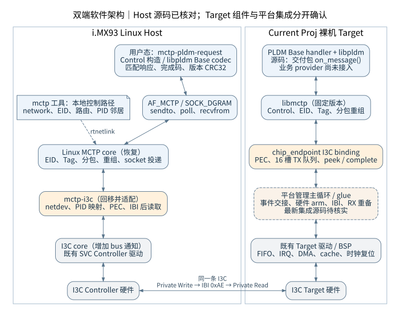
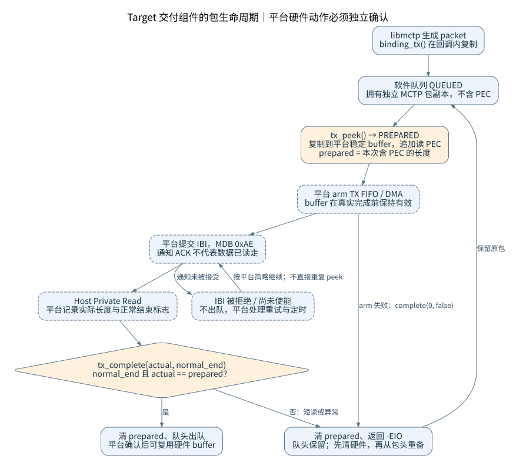
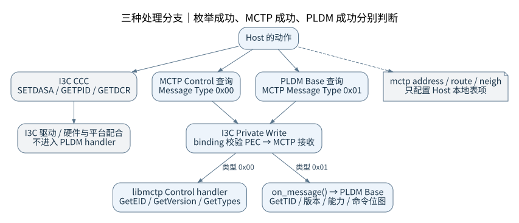

# MCTP/PLDM 移植后的双端软件架构

我们接下来要验收的，是一条完整的软件服务链：Host 发出管理请求，Target 接收并处理，准备好响应，再让 Host 取回结果。底层 I3C 原来已经能收发字节，这次移植是在它上面增加管理消息的寻址、分包、解析和响应生命周期。

先记住两侧最大的不同：**Host 把 MCTP 放在 Linux 内核，PLDM 编解码放在用户态；Target 在裸机环境运行 libmctp 和 PLDM Base handler，由平台主循环衔接 I3C 驱动。** 两边使用相同的线上协议，但内部软件实现并不对称。

这份文档先确定软件移植范围、模块边界和运行路径，为下一步编写验收 testcase 提供依据。它不代替正式测试计划，也没有在整理期间重新发包、复位或刷机。

## 1. 这份架构说明依据哪一版

整理日期为 **2026-11-27**。目前取得的最新双端联调记录结束于 **2026-11-26**；这里的“当前”以这批源码和证据为边界，没有通过访问开发板重新确认实时状态。

| 对象 | 这次能核对什么 | 不能据此确认什么 |
|---|---|---|
| Host 移植工作区 | 实际 Linux 源码、配置、工具和构建记录；包含 11 月 26 日修正的 requester | 基底 commit 不代表全部修改已经提交，也不代表重新构建后的产物已回归 |
| Host 实板运行结果 | `6.6.36-slim-mctp` 部署记录；枚举、绑定、7 项查询和分包日志 | 没有用这些记录证明所有长度、压力和异常恢复已通过 |
| Target 独立交付包 | 原始 ZIP、接口、端点实现、构建范围、离线验证记录 | 这是交付组件，不是最新运行固件的完整源码 |
| Target 集成结果 | 操作员确认、状态截图，以及实际返回的 Control/PLDM 响应 | 最新平台 glue、ISR、DMA、RX 重备实现与固件指纹仍未取得 |

文中按以下口径表述：**源码确认**指本次直接读到的实现；**实板记录**指已有日志或回传；**接入契约**指平台必须履行的接口条件；**待核实**指当前运行固件的实现身份或细节缺失。

Target 的独立包已经在本次文档附件中留存：[原始交付 ZIP](mctp-pldm-porting-architecture-20261127/chip-endpoint-kit-20261125.zip)。审阅摘录与 ZIP 对应文件逐字节一致，但不能因此认定后续板端固件未作修改。

## 2. 移植前后，究竟增加了什么

### 2.1 Host：从裸 I3C 测试入口，增加标准管理协议路径

移植前已有：

```text
i3c-host 等回归工具
    → 测试 companion / target_recovery
    → I3C core
    → SVC Controller 驱动
    → i.MX93 I3C 硬件
```

新管理路径是：

```text
mctp-pldm-request + libpldm Base codec
    → AF_MCTP socket
    → Linux MCTP core
    → mctp-i3c transport
    → I3C core / 原有 SVC Controller 驱动
    → i.MX93 I3C 硬件
```

旧回归工具继续用于底层验证；新协议请求不需要通过 `i3c-host` 或测试字符设备逐字节拼包。专用配置关闭了测试 companion，避免同一个 Target 被两条路径争用。

### 2.2 Target：在已有驱动上增加常驻管理端点

移植前已有 I3C Target 驱动、BSP、收发会话和 `i3c_test` 回归入口。历史上的测试握手、IBI 测试码，不构成 MCTP 或 PLDM 实现。

本次提供的新增部分是：

```text
PLDM Base 请求分发与 handler
    + libpldm 所需 codec
    + libmctp core / Control
    + I3C binding：PEC、包队列、准备与完成接口
    + 裸机运行环境兼容层
```

这些代码先作为独立组件交付，没有由本次移植工作直接写入原 baremetal 工程。后续 Target 维护者把组件接入实际固件；我们已经看到基础查询成功，但还缺少最新集成代码与版本对应材料。

## 3. 双端总架构



图中的层次是职责关系，不表示 Target 实际源码一定分成同名目录，也不表示每层各有一个线程。交付包为了便于集成，把 binding、端点入口和 PLDM Base handler 集中在 `src/chip_endpoint.c`。

| 层次 | Host 的实现 | Target 的实现或契约 |
|---|---|---|
| PLDM 命令 | 用户态 requester，编码、等待和解析 | `on_message()` 分发，Base handler 处理并编码响应 |
| MCTP 消息 | Linux 内核 `net/mctp/` | 固定版本 `libmctp` |
| I3C binding | 内核 `mctp-i3c.c` | `chip_endpoint_rx/tx_peek/tx_complete` 与平台 glue 共同完成 |
| 总线驱动 | 既有 I3C core、SVC Controller | 既有 I3C Target 驱动、FIFO/IRQ/DMA 会话 |
| 调度与资源 | 进程、socket、skb、netdev、发送线程 | 单实例、主循环、事件交接、稳定收发 buffer |

**Host 没有在用户态运行 libmctp；Target 没有 Linux socket。** Host 工具使用 libpldm Base codec，但 socket 收发逻辑由 requester 自己实现，并非直接启用 vendor 目录中的全部 transport backend。

## 4. Host 分别做了哪些移植动作

### 4.1 恢复 slim 内核裁掉的 MCTP core

原 slim 树缺少所需协议目录和构建入口。本次从同工程 donor 恢复 `linux/net/mctp/`，并接入网络 Kconfig/Kbuild。它提供：

- `AF_MCTP` socket 的创建、发送、接收和 Tag 关联。
- MCTP 本地地址、network、路由和邻居配置接口。
- 消息封装、分片、接收重组和投递。

构建产物中的 `CONFIG_MCTP=y`，意味着这部分编进内核，不是再加载一个名为“PLDM”的内核模块。Host 的 PLDM 编解码仍在用户态。

### 4.2 回移 Linux v6.8 的 I3C transport

引入 `linux/drivers/net/mctp/mctp-i3c.c`，并适配当前 6.6.36 工程。这里的 v6.8 是 transport 源码来源，不代表整颗内核升级到了 6.8。

transport 的主要责任是：为合适的 I3C bus 建立 `mctpi3cN`，按 PID 关联 Target，在发送时追加 PEC、执行 Private Write；接收匹配的 IBI 后执行 Private Read，校验并移除 PEC，再把 MCTP 包交给内核。

### 4.3 补齐 I3C bus 生命周期通知

改动位于 `linux/drivers/i3c/master.c` 和 `linux/include/linux/i3c/master.h`，新增：

```text
i3c_for_each_bus_locked()
i3c_register_notifier() / i3c_unregister_notifier()
I3C_NOTIFY_BUS_ADD / I3C_NOTIFY_BUS_REMOVE
```

transport 既要发现加载之前就存在的 bus，也要处理之后注册、注销的 bus。bus 删除时，应先停止相关发送和设备使用，再销毁 I3C Target 描述符。否则即使第一次查询能通，卸载或重新枚举仍可能留下悬空引用。

这些改动属于总线与 transport 的生命周期衔接，不是把 MCTP 解析塞进 Controller 的 FIFO 操作里。

### 4.4 适配实际读长度，限定首轮传输单元

当前 vendor I3C API 的 `len` 保留请求长度，真实收到的字节数在 `actual_len`。`mctp_i3c_read()` 读取完成后使用后者定位 PEC，避免把未接收的缓冲区内容纳入校验。

首轮采用：

```text
MCTP packet payload 上限：64 B
MCTP packet / netdev MTU：68 B
I3C 数据上限（含 PEC）：69 B
```

`dev->mtu/min_mtu/max_mtu` 都固定为 68；读路径的本地上限固定为 69。Target 广告 MRL/MWL 为 260，没有自动改变这个工程策略。

这里处理的是“最大允许量”与“本次实际量”的区别。GetTID 的短响应只占 11 B I3C 数据，不能拿 69 B 上限当成实际读回长度。

### 4.5 补齐失败清理、锁和队列交接

transport 区分 bus 全局列表锁、单 bus 的设备列表锁，以及单 Target 的使用锁。发送时按 PID 查设备并持有设备锁，删除时先阻止新使用，再等待活动发送退出。

`mctp_i3c_start_xmit()` 把 skb 交给待发送槽位，唤醒 `mctp_i3c_tx_thread()`；真正的 I3C 访问在后者调用的 `mctp_i3c_xmit()` 中进行。

这也是验收不能只看 `sendto()` 返回值的原因：应用交给内核以后，地址 NACK 仍可能在异步发送路径出现。成功或失败要结合 `tx_packets/tx_errors` 和 Controller 日志判断。

### 4.6 新增独立构建配置、DTB 与成套产物

专用 `mctp-lab.config` 产生 `6.6.36-slim-mctp`；专用 DTS 继承已有实验接线，给 I3C Controller 增加 `mctp-controller` 属性。所查构建配置为：

```text
CONFIG_MCTP=y
CONFIG_MCTP_TRANSPORT_I3C=m
CONFIG_I3C=m
CONFIG_SVC_I3C_MASTER=m
```

配套交付包括 Image、DTB、`i3c.ko`、`svc-i3c-master.ko`、`mctp-i3c.ko`、工具、配置和校验清单。模块必须匹配当前内核和构建依赖，不能仅修改 release 文本就宣称兼容。

本次 MCTP 移植相对基底没有修改 SVC Controller 源码，复用的是其已有 Private Transfer、IBI 和实际长度能力。既有实验配置与产品 SPI/GPIO 依赖保持隔离。

### 4.7 增加两类用户态工具，随后修正 socket 边界

| 工具 | 主要职责 | 是否产生管理总线事务 |
|---|---|---|
| `mctp` | 通过 rtnetlink 配接口、本地 EID、路由和 PID 邻居 | 本地表项配置本身不发送管理请求 |
| `mctp-pldm-request` | 构造一笔 Control 或 PLDM Base 请求，等待并解析响应 | 查询/设置子命令会产生真实请求 |
| requester 的 `--socket-check` | 创建并关闭 AF_MCTP socket | 不发包 |
| requester 的 `--selftest` | 内存中验证编码、匹配和解析 | 不发包 |

11 月 26 日修正了 requester 与当前 AF_MCTP 的契约：类型由 `smctp_type` 提供，`sendto()` 只提交正文；`recvfrom()` 取正文后，工具从源地址的 `smctp_type` 补回内部类型字节。

工具还做源 network/EID、消息类型、响应方向、Instance ID、命令、长度与完成码检查。默认响应等待为 30 秒，可用 `MCTP_TIMEOUT_MS` 调整；没有自动重试状态修改命令。超时不能证明对端从未处理过请求。

旧原始 bundle 与已替换的板端工具曾经不是同一版。正式验收必须锁定修正版二进制及其来源，不能只记录程序名字。

## 5. Host 运行时：控制路径与数据路径分开看

### 5.1 启动、发现和配置路径

```text
启动匹配的内核与 DTB
  → I3C core / Controller 注册
  → bus 通知促成 MCTP netdev 创建
  → I3C 枚举得到 Target 身份和 DA
  → mctp-i3c 匹配、绑定 Target，申请并启用 IBI
  → 配 network、本地 EID、路由和邻居
```

netdev 按 bus 建立，Target 绑定则建立该 bus 下的设备关联。因此“接口已经出现”和“这个 Target 已正确绑定、可通信”应分别确认。

当前配置为 network 1、Host EID 8、Target EID 9、Target PID `beee00000101`、DA `0x44`。本地路由不会替 Target 设置 EID；本轮没有部署 `mctpd` 或完整 OpenBMC 端点管理服务。

### 5.2 实际请求调用链

```text
main() → build_request()
  → sendto() → 内核 mctp_sendmsg()
  → mctp_local_output() / 必要分片
  → netdev / mctp_i3c_start_xmit()
  → mctp_i3c_tx_thread() → mctp_i3c_xmit()
  → i3c_device_do_priv_xfers()
  → svc_i3c_master_priv_xfers() → Controller
```

发送 slot 中的 skb 和硬件传输期间的 skb 不是无穷多个可并发操作的 buffer；netdev 停队、唤醒和发送线程共同衔接背压。`tx_skb` 是一个交接槽，不等于整个 Linux 发送系统只能缓存一个包。

### 5.3 响应调用链

```text
Controller 接收 IBI
  → I3C 框架调用 mctp_i3c_ibi_handler()
  → 检查 MDB 0xAE → mctp_i3c_read()
  → Private Read → 使用 actual_len 校验 PEC
  → netif_rx() → MCTP 接收、关联及必要重组
  → socket 接收队列 → recvfrom()
  → matches() → print_response() / PLDM 解码
```

I3C binding 不解释 TID；PLDM codec 不操作 I3C FIFO。MCTP Tag 与 PLDM Instance ID 各自负责本层的关联，不能只对其中一个字段就宣布响应正确。

## 6. Target 分别提供了哪些移植组件

这一节是**交付源码确认**。最新 Target 固件的目录和函数是否仍然同名，必须由后续集成材料确认。

### 6.1 固定版本与构建子集

| 组件 | 版本或位置 | 实际构建范围 |
|---|---|---|
| libmctp | `ab58506f08dbda562fccaa66340faad9c2e96fa4` | core、alloc、log、control、crc32 |
| libpldm | v0.13.0，`af271b8247d22935c062cacd578d74cc35b6ec45` | `src/dsp/base.c` 等所需 Base 编解码依赖 |
| 端点与 binding 入口 | `src/chip_endpoint.c` | 单实例状态、包队列、PEC、RX/TX 接口、Base handler |
| 对外契约 | `include/chip_endpoint.h` | 调用上下文、实际长度、DA、buffer 有效期和完成条件 |
| 运行环境兼容 | `compat/`、`src/compat.c` | 字节序、字符类型、ABI 宏、局部 libc 兼容 |

vendor 中带有某模块源码，不等于最终固件已经编译、启用并对外支持该模块。首版没有因此获得传感器、PDR、FRU 或固件更新服务。

产物 `libchip_endpoint.a` 是组件静态库，不是可直接烧写的固件。此前 RISC-V 交叉编译证明这个子集可以构建，最终集成仍需匹配芯片固件的 `-march/-mabi`、链接脚本、C runtime、堆和启动流程。

### 6.2 MCTP core 与 PLDM Base handler

`chip_endpoint_init()` 创建 libmctp 实例，注册一个 binding 和本地 EID，安装计时回调、消息接收回调，并声明支持 PLDM 类型。

Control 请求首先由固定版本 libmctp 的 Control handler 处理。PLDM 完整消息进入新增 `on_message()`：检查消息类型、方向及头字段，再按 PLDM Type/Command 分发。

首版 Base handler 实现：SetTID、GetTID、GetPLDMTypes、GetPLDMVersion、GetPLDMCommands。版本返回为 Base 1.1.0，命令位图为 `0x01`～`0x05`。版本列表附带 CRC32；这是 PLDM 数据的校验，与每包末尾的 I3C PEC 不同。

声明能力和实际 handler 要一起维护。只把某个 capability bit 置位，不能代表已经完成相应业务。

### 6.3 I3C binding 与软件 TX 队列

`binding_tx()` 接收 libmctp 生成的 packet，将它复制进端点自己的环形队列。该队列保存 MCTP 头和 payload，不保存最终 I3C PEC。

`chip_endpoint_tx_peek()` 取队头副本，按本次 DA 和读方向追加 PEC，复制到平台提供的稳定 buffer。这个函数不操作 FIFO、不启动 DMA，也不提交 IBI。

**真正“让硬件可读，再发 IBI”的动作由平台 glue 执行。** 包里有 `tx_peek()` 不等于包里已经实现了芯片 IBI 驱动。

### 6.4 运行支撑与隔离

交付接口是单实例、单线程契约：协议入口只由主循环串行调用，ISR 记录数据和事件，并及时完成必要的 FIFO/DMA 服务。共享状态交接所需的临界区、原子操作和 cache 同步属于平台实现。

默认使用 C runtime 的 malloc/free；可以在初始化之前替换 libmctp 分配器，但实例运行期间不能切换全局 allocator。需要单调毫秒时钟，不要求完整 Linux 时间服务。

兼容头只针对组件源文件生效，避免把本包的字节序或 libc 兼容定义扩散到原工程。原 `i3c_test` 保留独立入口，与管理模式切换设备所有权，不能并行消费同一组 RX/TX/IBI 会话。

## 7. Target 平台接入的六个主要接口

| 接口 | 谁在什么时候调用 | 输入与结果的含义 |
|---|---|---|
| `chip_endpoint_init(eid, tid, now_ms, arg)` | 管理模式启动，分配器和计时可用后，由主循环调用 | 初始化软件实例；没有替平台配置 I3C MMIO 或中断 |
| `chip_endpoint_rx(da, wire, actual)` | 一笔 Private Write 接收结束，主循环持有完整 RX 数据后 | `actual` 包含 PEC、不包含地址帧；返回 0 不等于业务成功或硬件已重新备好 RX |
| `chip_endpoint_tx_pending()` | 主循环检查待发状态 | 返回软件队列中的包数；不是 IBI 状态或硬件 FIFO 水位 |
| `chip_endpoint_tx_peek(da, wire, capacity, length)` | 硬件空闲、准备队头发送时 | 拷贝队头并加 PEC，置 prepared；成功后 buffer 必须有效到真实完成 |
| `chip_endpoint_tx_complete(actual, normal_end)` | 平台确认 Private Read 完成或失败后 | 只有正常结束且实际长度等于 prepared 长度才出队 |
| `chip_endpoint_deinit()` | 平台先停止 IRQ/DMA 和旧硬件访问后 | 销毁实例及协议状态；不能替平台中止正在使用 buffer 的硬件 |

另外提供 `chip_endpoint_pec()` 供绑定和离线验证使用，它是字节校验工具，不是硬件 PEC 的开关。

这六个入口把协议组件和芯片硬件隔开。验收时应分别检查“组件按契约返回了什么”和“平台是否据此完成硬件准备与清理”。

## 8. Target 的 buffer 和包，什么时候才能释放



### 8.1 RX buffer 与 libmctp packet

平台接收的数据至少要保留到主循环调用 `chip_endpoint_rx()` 完成；该函数检查长度、忙状态、PEC 和基础头字段，然后分配 libmctp packet，把数据复制进去。

固定 libmctp 版本的 `mctp_bus_rx()` 实际借用 packet，不负责释放；交付适配层在同步调用返回后释放它。该行为与当时头文件的所有权注释存在差异，不能升级库后机械沿用，必须重查实现和内存检查结果。

重组后交给 `on_message()` 的 message 也不是可供平台永久保存的裸指针。当前 handler 在回调期间完成解析并提交响应，不把这个指针交给异步硬件。

### 8.2 两份 TX 数据分别归谁

| 对象 | 所有者 | 有效期 |
|---|---|---|
| libmctp 交给 `binding_tx()` 的 packet | libmctp 发送路径 | 回调后不能假定仍可使用，binding 必须复制 |
| 16 槽软件队列中的包副本 | endpoint | 直到对应包完整正常读取后出队 |
| `tx_peek()` 写入的平台 TX buffer | 平台 glue / 驱动 | 硬件读取或 DMA 仍可能访问期间必须保持稳定 |

平台不能把短生命周期栈数组交给 DMA 后就返回，也不能在 IBI 被 ACK 时复用 TX buffer。通知成功与响应数据完整读走是两个事件。

### 8.3 prepared 状态和短读

`tx_peek()` 成功后记录本次准备长度。`tx_complete()` 判断：

```text
normal_end == true 且 actual == prepared
    → 清 prepared，队头出队

否则
    → 清 prepared，保留队头，返回 -EIO
```

短读或异常之后，需要平台先清理硬件残留，再从包头重新准备。若硬件 arm 失败，平台可用 `tx_complete(0, false)` 解除软件 prepared、保留队头；后续仍需按平台策略决定何时重试。

DA 从 peek 到 completion 之间也应保持一致；若改址或复位，应先撤销旧硬件访问，再重建发送状态，不能继续发送按旧地址计算的 PEC。

### 8.4 `-EBUSY` 不等于硬件自动 NACK

交付包在仍有响应排队或处于 prepared 状态时，`chip_endpoint_rx()` 返回 `-EBUSY`。平台需要保留已收到的包，稍后重新提交，或按明确策略处理背压。

这是主循环里的软件返回值，不能倒推出它已经控制了 I3C 地址 ACK/NACK。11 月 26 日连续分片的第二片失败在地址阶段，尚不能用这一行忙判断宣布找到根因。平台何时重新使能 RX、何时归还 buffer 和恢复地址应答，仍需最新集成代码与观测来解释。

## 9. 一笔 GetTID 的双端处理过程

下面把组件和平台动作接到同一笔事务上。Target 平台内部步骤是接入契约；收到成功响应证明这条基础功能链已有结果，但不证明当前固件内部一定使用相同函数名。

| 顺序 | Host | Target |
|---:|---|---|
| 1 | requester 编码 PLDM Base GetTID，指定 network 1、目的 EID 9 | 已处于管理模式，EID/TID 和 RX 接收已准备 |
| 2 | AF_MCTP 加消息类型，MCTP core 建包；transport 加 PEC | 等待 DA `0x44` 的 Private Write |
| 3 | Controller 发起写事务，记录传输结果 | 驱动得到实际 RX 长度和结果，ISR/事件交给主循环 |
| 4 | 应用等待响应 | binding 校验 PEC，libmctp 接收/重组，`on_message()` 处理 GetTID |
| 5 | 等待 | Base handler 取 TID、编码响应；libmctp 生成包，binding 复制入队 |
| 6 | 等待 | 平台 peek、准备稳定 TX 数据，再提交 MDB `0xAE` 的 IBI |
| 7 | IBI handler 检查 MDB，执行 Private Read | 驱动提供已准备的数据，按真实长度结束 |
| 8 | binding 用 actual_len 验 PEC，移除 PEC，上送 MCTP | 平台用真实完成事件调用 complete；满足条件才出队 |
| 9 | socket 收到消息，匹配响应并解析完成码、TID | 释放/复用已完成的硬件资源，准备后续请求 |

本例请求消息是 `[01][PLDM header 3 B]`，加 4 B MCTP 头和 1 B PEC 后为 9 B I3C 数据；成功响应多出完成码与 TID 两字节，为 11 B。地址帧不计入这些数据长度。

已有 GetTID 日志中，Host TX bytes 增加 8、RX bytes 增加 10，因为 netdev 统计包含 MCTP 头、排除了 PEC。这些数值和上述 9/11 B 并不矛盾。[原始记录](mctp-pldm-porting-architecture-20261127/evidence/03-base-get-tid.log)

## 10. 三条不同层次的命令路径



| 命令或动作 | 线上与处理层次 | 可以确认什么 |
|---|---|---|
| SETDASA、GETPID、GETDCR 等 CCC | I3C 管理流程，部分由硬件自动处理、部分由平台配合 | I3C 身份、寻址或能力，不直接证明 PLDM handler |
| MCTP GetEID / GetVersion / GetMessageTypeSupport | Private Write 承载类型 `0x00`，由 Control handler 处理 | MCTP 管理消息及相应响应 |
| PLDM GetTID / GetPLDMTypes 等 | Private Write 承载类型 `0x01`，进入 Base handler | 对应 PLDM 命令与能力 |
| `mctp route/neigh/address` 本地配置 | Host rtnetlink，不是远端 SetEID | 本地发送路径已建立 |
| `bmc start` | 本轮操作员使用的 Target 管理入口 | 是平台服务启动入口；其完整内部实现仍待核实 |

因此，验收不能只发几条 CCC 就结束，也不能把 GetEID 算成 PLDM Base 用例。Host/Target 的软件命令与总线上协议动作要分别记录。

## 11. 首轮架构参数与能力边界

| 项目 | 当前可确认的值或策略 | 适用范围 |
|---|---|---|
| 拓扑 | 单 Host、单 Target、I3C SDR、IBI 通知 | 当前联调；没有桥接或多端点管理验收 |
| Host 内核 | `6.6.36-slim-mctp` | 已有部署和联调记录 |
| 固定标识 | network 1，Host EID 8，Target EID 9，TID 1 | 当前实验配置，不是产品永久地址规划 |
| transport | MCTP 68 B，I3C 数据含 PEC 69 B | Host 当前工程上限；短消息按实际长度 |
| Target 最大消息 | 512 B | 交付包 libmctp 配置，不代表已完成 512 B 实板验收 |
| Target 重组上下文 | 2 | 交付包编译配置，不代表平台可并行服务两笔业务 |
| Target TX 队列 | 16 槽，每槽最多 68 B，不含 PEC | 交付包静态数据副本队列 |
| Target PLDM handler | 只实现 Base 五条命令 | 没有真实传感器/PDR/FRU/固件更新 provider |
| Target 调度 | 单实例、主循环串行入口 | 交付契约，最新固件具体执行点待核实 |
| PEC | 本轮软件 PEC；Target 回传为硬件关、软件开 | 需锁定每轮配置，避免重复添加或重复剥离 |

512 B 消息上限、16 个 TX 槽位和 2 个重组上下文，分别描述不同资源，不能相乘得到“并发业务容量”。当前 handler 的响应缓存和能力范围也不能仅凭上游库上限推导。

## 12. 已验证部分与仍需验收的架构接口

| 对象 | 已有证据 | 尚缺的验收 |
|---|---|---|
| Host 构建和装载 | 内核/模块构建、部署、socket 创建 | 从最终冻结版本重建并回归 |
| Target 协议组件 | 内存协议测试、ASan/UBSan、RISC-V 静态库构建 | 当前实际固件与组件、配置和产物的对应关系 |
| 基础端到端查询 | Control 三项、PLDM Base 四项，7/7 通过 | 状态修改命令与完整异常组合，不能由只读结果代替 |
| Host 分片/重组 | 本地回环 63/64/65/129 B 数据比较通过 | I3C + Target 的完整分包重组 |
| 实板发送边界 | 68/69 B 单包 Host 发送成功 | Target 实际长度/PEC 交叉证据与满包响应 |
| 连续两片 | 无间隔 69+6 B，第二片地址 NACK；重枚举后复现 | RX 重备、地址应答与时间关系的定位和回归 |
| TX 生命周期 | 组件离线短读保留队头测试通过 | 真正硬件短读、IBI 拒绝、DMA/IRQ 完成和恢复 |

间隔约 1 秒后两片 Host 发送成功，只是临时 AF_PACKET 重放实验；正式 transport 没加固定延时，Target 重组也未确认。这个结果应作为后续时序定位线索，不能写成架构已经靠延时修复。

## 13. 下一步 testcase 应围绕哪些接口设计

这一步先划分验收对象，不展开成完整 testcase：

| 边界 | 后续要回答的核心问题 | 应当能看到的证据 |
|---|---|---|
| 构建/启动 → 可用组件 | 加载的究竟是哪套内核、模块和固件？ | 双端版本、工作树差异、镜像与工具指纹、配置 |
| I3C 枚举 → MCTP 绑定 | 身份、DA、能力、IBI 是否与本轮一致？ | CCC 结果、驱动绑定、接口和事件使能 |
| 应用 → AF_MCTP | 类型和正文是否交接正确，响应是否属于当前请求？ | 用户态编码、返回长度、Instance ID、命令、完成码 |
| MCTP → transport | 单包/分包、Tag 和错误传播是否正确？ | Host 软件包、内核统计、真实传输结果 |
| Target 驱动 → endpoint RX | 实际长度、PEC、buffer 归还与下次接收是否一致？ | Target RX/IRQ/重备记录，必要时波形 |
| Target TX 队列 → 硬件 → complete | 什么时候允许通知、出队和复用 buffer？ | pending、prepared、IBI、实际读长度、结束状态 |
| 复位/改址 → 新会话 | 旧包、旧 PEC、旧事件是否会污染新请求？ | 会话代际、清理过程、重枚举与下一笔正常查询 |

Target 交付组件并没有自带完整的 `rx_packets/ibi_submitted/tx_short_reads` 观测系统。部分字段在已有平台截图中出现过，验收时应由当前集成提供等价日志，而不是假设库里已经维护了所有计数。

就现有问题而言，最先需要补齐的是：**第一片完成后谁重备 RX，何时恢复下一次地址应答；以及 Private Read 的真实完成如何触发软件出队。** 这两个位置正好处于协议组件和硬件平台之间。

## 14. 源码阅读顺序与证据索引

### 14.1 Host 阅读入口

下列 `H` 路径以 Host 独立工作区为基准，`linux/` 是该工作区中的内核树。源码路径与具体符号一起使用，不依赖会随修改漂移的行号。

| 顺序 | 路径与符号 | 看什么 |
|---:|---|---|
| 1 | `H/linux/vendor/intellif/tools/mctp-host/mctp-pldm-request.c`：`build_request/main/matches/print_response` | 请求、socket 契约、响应判断 |
| 2 | `H/linux/net/mctp/af_mctp.c`：`mctp_sendmsg/mctp_recvmsg` | 用户消息与内核消息的边界 |
| 3 | `H/linux/net/mctp/route.c`：`mctp_local_output/mctp_do_fragment_route/mctp_route_input` | 分片、关联、重组和 socket 投递 |
| 4 | `H/linux/drivers/net/mctp/mctp-i3c.c`：`setup/start_xmit/tx_thread/xmit/read/ibi_handler` | netdev、PEC、队列、IBI 与实际长度 |
| 5 | `H/linux/drivers/i3c/master.c`：bus notifier；`H/linux/include/linux/i3c/master.h` | bus 注册、注销和 transport 生命周期 |
| 6 | `H/linux/drivers/i3c/master/svc-i3c-master.c`：`svc_i3c_master_priv_xfers` | 既有底层传输入口；本篇不展开寄存器逐项审计 |

本地工作区入口：[Host 源码目录](../../../../code_wave_hw/worktrees/imx93-slim-mctp-20261125/)。这是本机相对位置，不代表该工程已包含在博客仓库内。

### 14.2 Target 交付组件阅读入口

`K` 表示原始 ZIP 解压后的 `chip-endpoint-kit` 根目录。为方便核对，文档附带了少量[审阅摘录](mctp-pldm-porting-architecture-20261127/review-target-kit/README.md)；完整构建源码仍以 ZIP 为准。

| 顺序 | 路径与符号 | 看什么 |
|---:|---|---|
| 1 | [K/include/chip_endpoint.h](mctp-pldm-porting-architecture-20261127/review-target-kit/include/chip_endpoint.h) | 单线程契约、长度和 buffer 有效期 |
| 2 | [K/src/chip_endpoint.c](mctp-pldm-porting-architecture-20261127/review-target-kit/src/chip_endpoint.c)：`init/rx` | 初始化、PEC、packet 所有权、进入 libmctp |
| 3 | 同文件：`on_message` | PLDM Base 分发、能力与错误响应 |
| 4 | 同文件：`binding_tx/tx_peek/tx_complete` | 副本队列、prepared、实际完成和短读保留 |
| 5 | ZIP 中 `vendor/libmctp/core.c/control.c` | 消息重组、Control 分支和发送回调所有权 |
| 6 | [K/Makefile](mctp-pldm-porting-architecture-20261127/review-target-kit/Makefile)、`compat/` | 真正编译的模块与平台依赖 |
| 7 | [K/tests/test_endpoint.c](mctp-pldm-porting-architecture-20261127/review-target-kit/tests/test_endpoint.c)、[VALIDATION.md](mctp-pldm-porting-architecture-20261127/review-target-kit/VALIDATION.md) | 离线覆盖范围，不将其当成实板结果 |

交付 ZIP 的 SHA-256 为：

```text
2e1d46969d0d0430f623039c35b24486f244fcb96f0e91a270f765de6b569c8d
```

### 14.3 本轮保留的观测记录

- [Host GetEID 修复后的查询](mctp-pldm-porting-architecture-20261127/evidence/get-eid.log)
- [PLDM GetTID](mctp-pldm-porting-architecture-20261127/evidence/03-base-get-tid.log)
- [PLDM GetVersion 与 CRC32](mctp-pldm-porting-architecture-20261127/evidence/05-base-get-version.log)
- [PLDM GetCommands](mctp-pldm-porting-architecture-20261127/evidence/06-base-get-commands.log)
- [重枚举后的绑定与路由](mctp-pldm-porting-architecture-20261127/evidence/mctp-binding-and-route.log)
- [无间隔分片复现](mctp-pldm-porting-architecture-20261127/evidence/fragment-no-delay.log)
- [本次审阅版本与源码指纹](mctp-pldm-porting-architecture-20261127/review-manifest.json)

附件日志保留原样；其中板端路径仅作为历史证据，不表示文件已进入当前源码仓库。已有交付说明里的“尚未部署”，描述的是交付当时，后续部署与联调结果按上述日志和会话时间区分。

## 15. 正式验收前还要冻结什么

Host 工作区基底为 `c58292616eeed014c605d572ae3f58a5c7095b43`，MCTP 移植及 requester 修正仍在未提交修改中。修正版 requester 二进制 SHA-256 为：

```text
e3717b9327c1d886655bcb82f418ffeccbd518345ee0630bbdb6d1c69083ca1b
```

基底提交、当前工作树、原始 bundle、板端替换后二进制必须分别记录。它们不能只用一个“6.6.36”版本名代替。

Target 需要补充最新固件的源码身份、实际组件版本、平台 glue、构建选项、镜像指纹与观测入口。用户已经确认新版取消了旧普通 PIO 16 B 限制，本篇没有继续沿用旧限制，也不以旧裸机源码代替新固件。

这份材料可以作为 testcase 的**架构草案与历史证据起点**。要把它升级为正式验收基线，还需要将双端源码、实际产物和本轮配置对应起来；若代码进入 master，也要分别确认合入、重建、部署和硬件回归，不能把“已合入”当作“该版本已验收”。
