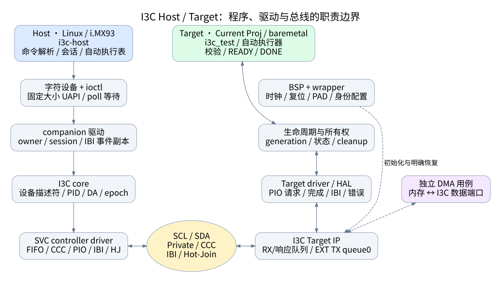
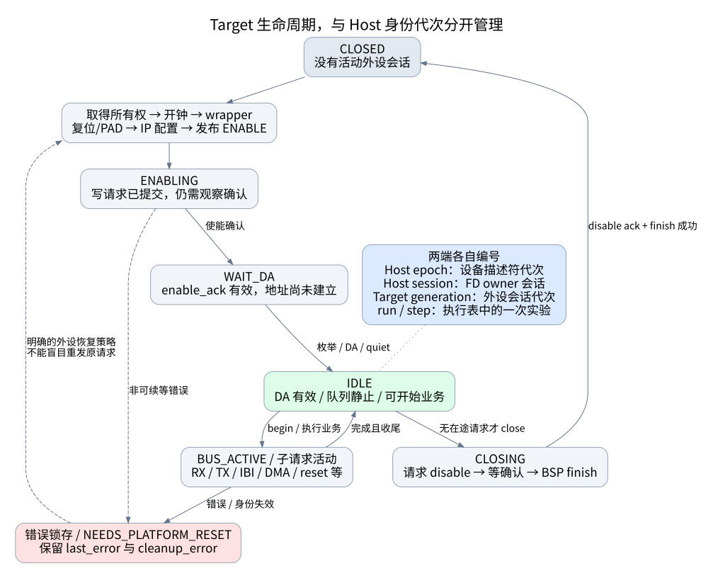
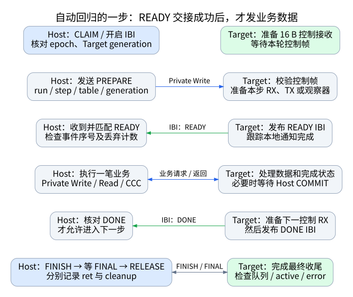

最早做 I3C 联调时，我们的操作很直接：Target 先准备接收或发送，Host 再写几个字节、读几个字节，两边各看一份日志。数据能对上，就继续往下做。

真正让事情变复杂的，是后面的这些问题：Target 重新枚举以后，Host 之前打开的句柄还能不能用？一条 IBI 已经到达 Host，Target 的通知状态是不是也完成了？读到一半结束、修改最大长度、重启外设以后，谁负责把下一笔业务准备好？

这篇文章把 MCTP/PLDM 之前的那套工程重新整理一遍：Host 上是 Linux、`i3c-host` 和测试 companion 驱动；Target 上是 Current Proj 裸机固件、I3C Target 驱动和 `i3c_test` 执行器。范围覆盖枚举、CCC、PIO、IBI、独立 DMA 用例、Hot-Join 以及复位恢复。

截至本文整理时，历史材料中已有多轮双端功能通过，也有失败、仅 Host 通过和证据不完整的记录。尤其是 11 月 19 日的 12 项独立回归，不能直接改写成“所有功能、所有版本、所有环境均通过”。下面按实际发生的阶段展开。

<!-- more -->

## 1. 先看两端分别运行什么



[查看高清 PNG](/2026/11/27/i3c-host-target-architecture-regression/architecture.png) · [下载 SVG](/2026/11/27/i3c-host-target-architecture-regression/architecture.svg)

Host 与 Target 是两台各自运行程序的机器。它们之间共享的是 SCL、SDA 上的协议，没有共享 APP 内存，也没有一个双方都能直接访问的软件队列。

| 一侧 | 组件 | 负责什么 |
|---|---|---|
| Host 用户态 | `i3c-host` | 解析命令，维持会话，检查结果，按自动执行表推进实验 |
| Host 驱动入口 | companion 字符设备与 ioctl | 管理 owner、长度、事件缓存和失败收尾，隔离用户态与内核对象 |
| Linux I3C core | 总线与设备模型 | 管理地址、PID、设备描述符、枚举及描述符代次 |
| Host 控制器驱动 | SVC | 将 CCC、Private Transfer、IBI、Hot-Join 对应到控制器操作 |
| Target CLI 与执行器 | `i3c_test`、auto/full/all 等 | 设置本轮预期、运行测试、比较数据、准备通知与收尾 |
| Target 驱动 | 生命周期、PIO、IBI、reset、独立 DMA 接口 | 保护会话，服务队列，检查完成，保存错误和恢复状态 |
| Target BSP / wrapper / HAL | 平台环境与寄存器访问 | 开钟、配置身份、复位、PAD 配置与具体 MMIO |

这里的 `i3c-host` 是实验工具，不是 Linux I3C 子系统本身；companion 也不是另一个总线控制器。它利用 core 和 SVC 已有能力，给联调增加一个能明确控制、等待和记录结果的入口。

本文讲解源码主要采用 Host `c053d9bb31abbd4a040dd4c2ae22765b931d5aa1` 与 Target `33e17bc171c09418eaa844797ef19a9976a27390`。这两份版本用于读架构；每轮实验实际运行什么，仍按后文的版本与日志关联判断。[代码阅读摘录](/2026/11/27/i3c-host-target-architecture-regression/source-reading-guide.txt)

## 2. Host 为什么从 sysfs 走到了会话化 APP

早期 sysfs 入口适合人工单步操作。比如先解除本地门控，发一笔读写，再读结果。但用例多了以后，同一个实验里会同时存在设备状态、准备状态、IBI 订阅，以及用户还没取走的结果。只靠几次独立的文件写入，很难表达“这几步属于同一个调用者”。

后来增加字符设备和 ioctl，一次打开的 FD 对应一个软件会话。短命令可以自动 claim、执行和 release；需要等待多条 IBI 或连续推进步骤时，则保持会话不关闭。

### 2.1 一份固定大小的数据契约

UAPI 的核心是 `struct i3ch_request`。这一版 APP 在编译时检查它的大小为 **392 字节**，内部数据区是 **260 字节**。请求和结果使用同一个结构，包含：

- `abi/op`：接口版本和操作类型；
- `epoch/session/pid`：设备描述符代次、调用者会话和身份；
- `length/actual`：请求长度与这次操作能确认的实际长度；
- `status/cleanup_error`：业务结果与收尾结果；
- 能力、地址、IBI 状态及事件计数；
- 固定长度数据区与必须为零的保留字段。

它没有把用户态指针嵌进结构。这样 ABI 的大小、对齐和数据边界可以明确检查，内核也能先检查参数，再决定是否改变状态或上总线。

**260 字节缓冲区不等于任何命令都能读 260 字节。** 当前 companion 的读上限、控制器的终止长度、工具的结果导出，以及 Target 本轮声明的 MRL，都是不同层面的约束。

### 2.2 owner、session、epoch 各管一件事

| 标识或资源 | 谁维护 | 防止什么问题 |
|---|---|---|
| owner | companion | 两个进程同时改变同一个 Target 的测试现场 |
| session | companion 的 FD 会话 | 后来的调用者冒用之前的操作上下文 |
| epoch | I3C core 的设备描述符 | 同 PID、同地址重新发现后，旧会话继续操作新实例 |
| generation | Target 外设会话 | Target 复位、重新打开后，旧 RX/TX 或测试步骤继续推进 |
| run、step、nonce 等 | 具体自动协议 | 迟到通知或上一轮控制帧误推进这一轮 |

一个关键点是：**地址相同，也可能已经不是同一代设备实例。** Hot-Join 后若仍取得原来的 DA，仅比较 DA 不够；core 更新描述符后，Host 需要识别 epoch 的变化。Target 的 generation 则是另一端维护的编号，两者不能相等比较，也不保证同步递增。

在 `recovery_ioctl()` 中，驱动先检查 ABI、保留字段、权限和长度，再取得业务锁。需要所有权的操作会核对当前 FD 是否为 owner、session 是否匹配，以及 epoch 是否仍有效。真正访问设备时，还需要 core 在受保护的路径里检查描述符，不能把用户态刚读过一次 info 当成永远有效的凭据。

### 2.3 为什么不自动重发失败命令

有一种情况很容易误处理：业务已经上了总线，但将结果复制回用户空间时失败，APP 收到 `EFAULT`。

这时可以确定“用户空间没拿到结果”，不能确定“Target 没收到数据”。所以驱动保留本 FD 的操作快照，APP 可以查询 `RESULT`；它不会自动再写一遍。重复写可能让 Target 多收一包，重复读则可能取走下一份数据。

IBI 出队也采用相同的谨慎顺序：先取得队首快照，成功 `copy_to_user()` 后才从软件队列移除。用户拷贝失败，不应悄悄丢掉这条事件。[Host 所有权、回调和出队代码](/2026/11/27/i3c-host-target-architecture-regression/source-reading-guide.txt)

## 3. Target 不能只靠一个 open/close 布尔值

Target 在另一个时钟域里工作。CPU 已经写入使能请求，不意味着 I3C IP 已经完成使能；已经有动态地址，也不意味着业务队列和全部软件请求都已空闲。



[查看高清 PNG](/2026/11/27/i3c-host-target-architecture-regression/lifecycle.png)

### 3.1 初始化顺序为什么拆成几层

这套实现将 BSP 与 wrapper 分开：BSP 管平台环境，wrapper 管本实验选择的身份和能力输入，Target 驱动再配置 IP 自己的状态。

主要顺序是：

```text
取得外设会话所有权
  → BSP 开钟
  → wrapper 配置身份与相关参数
  → BSP 复位、屏障与 PAD/monitor 配置
  → 读取初始快照，确认队列、地址和能力
  → 配置 IP，读回验证
  → 发布 ENABLE
  → 等待使能确认、动态地址与空闲条件
```

wrapper 要放在开钟之后、外设复位之前，让 IP 的复位初始化使用本轮身份输入。发布 ENABLE 之前发生错误，可以在条件允许时回滚已修改项；已经尝试发布之后，就不能因为软件返回超时而立刻断钟、重置所有上下文。

这里也有版本演进：9 月早期 case_004 使用专门的 DV 初始化路径；后来统一 open 中，`ADAPTIVE=0`，Hot-Join 由会话策略单独选择，响应分片配置为 32 字节。**不能把早期某个寄存器值直接当成所有后续固件的初始化要求。**

本机 DWC databook 的 §4.2.11、印刷页 217 说明：使能可能依赖 SCL；特定生成参数下，POR 后需要一次以 STOP 结束的 placeholder 传输来提供时钟。它解释了为什么 Target 先执行初始化后，仍可能需要 Host 配合供钟。它不意味着每一种 I3C IP 都必须执行我们早期那套三次供钟流程。

### 3.2 状态快照和推进动作要分开

`i3c_target_get_status()` 以快照判断 enable、DA、队列和错误；它不会替调用者 pop RX FIFO、消费发送完成，或发布 RESUME。

收发请求由单独的有限推进接口处理，例如：

```text
RX：WAIT_RESPONSE → WAIT_DATA → WAIT_IDLE → DONE
TX：WAIT_COMMAND  → WAIT_IDLE → DONE
```

RX 一次 step 至多消费一条响应和一个数据 word，避免同一次调用无限等待；已经消费过的条目保留在软件结果中，不会因下一次 poll 再消费一遍。`rx status`、`tx status` 则只查看缓存结果。

如果命令返回 `-EINPROGRESS`，含义是这次请求还在推进，不是失败，也不是完成。若取消只结束了软件等待，也不能据此假定线上传输已被硬件终止。

### 3.3 close 为什么有两个阶段

正常 close 先确认没有活动 RX/TX、IBI、DMA、reset 或长度恢复请求，再确认硬件 quiet。第一次调用请求关闭，进入 `CLOSING`；后续调用确认 disable 已生效，最后才由 BSP finish 归还时钟等资源。

如果刚开始 enable 还没跨到目标时钟域，读到 ENABLE=0 不应被误判成“关闭成功”。如果已经请求关闭但确认迟到，软件也要保留 CLOSING 和所有权，不能在错误返回后忘记自己已经发过 disable。

这些状态看起来比一个布尔值麻烦，却让“请求已经提交”“硬件已经确认”“资源已经释放”三个时刻有了各自的位置。[Target 初始化、PIO 契约与 close 摘录](/2026/11/27/i3c-host-target-architecture-regression/source-reading-guide.txt)

## 4. 用一笔 5 字节传输看数据到底经过哪里

先统一方向：**Host Write 对应 Target RX，Host Read 对应 Target TX。** Target 的 `tx 5` 是准备供 Host 读取的数据，不是主动发送一次普通 Private Transfer。

### 4.1 Host 写入，Target 接收

1. Target 执行 `i3c_test rx 5`，建立本轮期望并保存 generation、sequence 和地址。
2. Host 把 `11 22 33 44 55` 交给 ioctl，companion 和 core 检查后，由 SVC 发起 Private Write。
3. Target 硬件把数据放进 RX FIFO，把长度、分片和错误信息放进响应队列。
4. Target 前台推进 RX 请求，消费响应和数据，检查 copied、长度、图样及最终空闲。

**响应队列里的完成信息和 RX FIFO 中的字节是两份东西。** 读到了响应，不代表已经把所有字节搬到软件缓存。

在历史样本中，前四个字节对应数据 word `0x44332211`。这反映了该读口与软件拆字节的排列，不能把它当成总线上先发 44。对 5 字节数据，需要再取一个 word，但第二个 word 只复制一个有效字节。若每次都复制完整 4 字节，就可能越过本轮长度或破坏哨兵区。

因此，1、3、4、5 字节是很有价值的一组长度：它们分别检查一个字节、不完整 word、完整 word，以及跨 word 后的单字节尾部。[9 月短包验证摘录](/2026/11/27/i3c-host-target-architecture-regression/evidence/e02.txt)

### 4.2 Target 备数，Host 读取

Target 发送路径先确认没有旧 completion，再把本轮数据复制到驱动持有的缓冲区、预填扩展 TX queue0，设置有限长度，最后发布命令。

顺序不能倒过来：如果先宣布命令有效，再慢慢填数据，Host 的时钟可能已经到来。

Host 读回以后，要检查 `actual` 和完整内容；Target 则检查本次新 completion、错误、remaining 和队列状态。这是两端不同的证据，不能互相替代。

还有一个日志细节：Host Write 的 `actual=0` 在这一版接口里不提供 Target 已收字节数，它不表示“这次写了零字节”。写入长度要结合请求、控制器结果和 Target 的实收记录判断。11 月的失败定位中，这一点尤其容易造成误读。

## 5. IBI 有三个完成点

IBI 可以把人工接力改成事件驱动，但通知本身也有生命周期。

| 观察点 | 能证明什么 | 还不能证明什么 |
|---|---|---|
| Target 打印 READY | 程序走到了某个本地准备位置 | SIR 已发布、总线发送完成或 Host 已取到事件 |
| Host 收到 IBI | 通知已经进入 Host 接收路径 | Target 软件已经完成本次通知收尾 |
| APP dequeue 并匹配成功 | 本条消息交付给当前等待步骤 | 下一步业务已经执行并完成 |

在参考实现里，Target 通过专门的 SIR 数据寄存器准备最多 4 字节 payload，MDB 另计。所以 MDB 加 4 字节 payload，是 Host 看见的 5 字节消息。这个供数限制来自当前实现，不能用 Host 的大缓存替它放宽。

Host 一侧还有两层缓存：core/控制器接收 slot，以及 companion 为 APP 保留的事件副本。这版 companion 申请 4 个 slot、单条容量 16 字节，另有 16 条软件事件缓存。字节数、slot 数、事件条数不能混算。

IBI 回调只做长度检查、复制、计数和唤醒，使用短时队列锁，不取得业务 mutex。原因很具体：关闭 IBI 可能等待回调完成；如果回调反过来等待关闭者持有的业务锁，就可能相互等待。

队列满记 `dropped`，非法长度记 `invalid`。这些是到达 companion 的消息统计，不能当成整个控制器所有错误的总账。[IBI 长度与超限实验](/2026/11/27/i3c-host-target-architecture-regression/evidence/e04.txt)

## 6. 自动执行表怎样把人工步骤串起来

人工短包阶段，我们明确规定“Target READY 后 Host 才发”。自动化没有取消这个条件，而是把它写成控制帧和 IBI 握手。



[查看高清 PNG](/2026/11/27/i3c-host-target-architecture-regression/handshake.png)

### 6.1 PREPARE、READY、业务、DONE

以最早的 `auto normal` 为例，一轮固定包含 Write4、Read4、业务 IBI 和 GETSTATUS。Host 先发 PREPARE，Target 准备本步资源后发 READY；Host 匹配通知，才做这一笔业务。

遇到需要显式确认的步骤，Host 再发 COMMIT。Target 完成本步并准备下一条控制接收后发 DONE。最后 Host 发 FINISH，等待 FINAL，再释放会话。

“先准备下一条控制 RX，再发 DONE”并非排版习惯。Host 收到 DONE 后可能马上发下一帧，Target 若先通知、后准备，就人为制造了一个窗口。

### 6.2 16 字节控制帧装了什么

Table 1 的控制帧布局如下，来自 `i3c_auto_protocol.h`：

| 偏移 | 长度 | 内容 |
|---:|---:|---|
| 0～1 | 2 B | magic：`A`、`U` |
| 2 | 1 B | 协议版本 |
| 3 | 1 B | PREPARE、COMMIT 或 FINISH |
| 4～5 | 2 B | 本轮 run，小端序 |
| 6 | 1 B | step |
| 7 | 1 B | table 版本 |
| 8～11 | 4 B | Target generation，小端序 |
| 12～15 | 4 B | 前 12 字节的 32 位校验值 |

这里的校验采用源码中的逐字节异或、乘法算法，**不是 CRC32**；长包数据的 CRC32 是另一个协议字段，不能因为都叫“校验”就混用。

Table 1 的通知是 `A5 + run低字节 + run高字节 + step + event`。10 月 1 日实测 run=11873，即 `0x2e61`，因此第一条 READY 为 `a5 61 2e 01 01`。APP 还要与业务 IBI `a5 11 22 33 44` 区分，不能只见到 MDB=A5 就推进。[自动四步实验与时序](/2026/11/27/i3c-host-target-architecture-regression/evidence/e06.txt)

后来的 `all` 有自己的启动与阶段通知：BOOT 使用 `0xd7`，阶段通知使用 `0xd6`，控制帧及阶段编号也按自己的协议解释。**auto/full/all 不是一个名字不同、格式完全相同的万能执行器。** 两端必须使用匹配的表和协议版本。

### 6.3 状态修改步骤为什么需要特殊交接

第一个典型问题是 SETMRL。早期 full 在修改长度后马上 GET，Target 却进入了 HALT。之后改成：Target 设防，Host 只发送 SETMRL，Target 明确发布 RESUME 并检查完成，再通知 Host 回读及继续业务。

第二个问题是 RSTDAA。Host 已收到 READY，随后清除了 DA，但 Target 的旧 IBI poll 还在要求原地址有效，于是把预期地址失效误判为错误。修复不是放宽所有 IBI 的地址检查，而是为这一步限定特殊会话：先有本次通知的成功完成证据，再允许观察到预期的 DA 失效。[33 步回归记录](/2026/11/27/i3c-host-target-architecture-regression/evidence/e07.txt)

这两次都说明：业务表里如果包含“改变另一端前提”的动作，通知被收到与通知软件收尾之间的窗口就必须处理。

## 7. 把“长度”拆成五个概念

我们在这些实验里遇到过多次长度问题，它们其实落在不同层。

| 长度 | 本工程中的例子 | 容易混淆的地方 |
|---|---|---|
| 软件缓冲容量 | UAPI `data[260]` | 不代表每种操作都接受 260 B |
| 接口允许上限 | 短 PIO 接口 1～16 B；companion 参考读上限 255 B | 是具体接口约束，不是 I3C 协议的统一上限 |
| 对端公布能力 | MRL、MWL，以及 IBI 长度 | 本轮必须回读，不能只照抄旧日志 |
| 硬件分片 | Target 响应分片配置 32 B | 一条长业务包可以产生多份硬件完成信息 |
| 实际有效长度 | GETCAPS 实收 3 B、Private Read 的 actual | 最大读取容量不等于这次一定读满 |

9 月 GETCAPS 的问题很有代表性。旧 Linux 路径把 `0x95` 按一字节 GETHDRCAP 处理，而该实验实例按较新能力格式准备三字节 `01 f1 18`。日志中的 `rx=1/1` 只能说明“读满了软件要求的一字节”，不能说明对端整个响应自然结束。

后续修改方向是允许最大容量、按实际长度解释，并保持旧设备响应的兼容；不是在 DTS 随便加一个“读取三字节”字段。历史日志里的 CCC ongoing 残留也不能未经证明就写成后续 NACK 的唯一根因。[长度定位与修复记录](/2026/11/27/i3c-host-target-architecture-regression/evidence/e05.txt)

## 8. DMA 加进来以后，完成条件还得再加一层

普通 `i3c-host` Private 读写走 Host 的 SVC PIO。后来独立 DMA 用例改变的是 **Target 内存与 Target I3C 数据端口之间的搬运**，不能据此说 Host 也使用了 DMA。

Target DMA RX 的源码把几个结果分开保存：`dma_done`、`protocol_done`、数据比较和 guard 检查。只有 DMA 搬运完成不够，I3C 协议响应也要表明长度、错误和分片状态正确，队列最后还得符合收尾条件。

缓存也不能靠猜。参考用例让整条 cache line 归这次传输所有，DMA 范围外放 guard；交给设备前调用设备方向同步，完成并确认交接后，再同步给 CPU 做比较。否则 CPU 可能拿着旧 cache 内容，或缓存维护误伤旁边不属于该传输的数据。

11 月 20 日留有多个 4、8、12、16 字节配合 DMA 用例的 Host 日志，读回图样和请求结果可以检查。但 Host 看不到 Target 是否真的完成了 DMA。**单靠这些 Host 日志，不能补写 Target DMA 的最终验收状态。**[Host 记录脱敏汇集](/2026/11/27/i3c-host-target-architecture-regression/evidence/e17.txt)

`all smoke` 的范围声明则明确排除了 DMA 和 I²C。一个 9/9 的 all 结果，不会自动覆盖独立 DMA 用例。

## 9. 恢复不是一个 reset 命令

这套工程至少有四种需要分开记录的“恢复”。

### 9.1 提前结束有限读：丢弃旧包，重新准备新包

Target 原来准备了更长的数据，Host 提前终止时，会留下完成信息、remaining 或 HALT 状态。可恢复 TX 接口只接受特定的“提前结束”条件，然后撤销旧命令、清理对应队列、发布一次 RESUME，再确认可以准备新包。

恢复成功表示旧包已丢弃、新业务可开始，不表示旧包完整发送。

11 月 19 日 M=5 的实验先短读，再执行恢复，之后完整读回新的 16 B 和新的 5 B。两个新图样的读回，才是“没有继续吐旧数据”的业务证据。[独立回归中的提前终止步骤](/2026/11/27/i3c-host-target-architecture-regression/evidence/e16.txt)

### 9.2 软件外设复位：旧动态地址也要验证失效

10 月 13 日 swreset 实验在 DA=`0x30` 完成业务，再预置一份不同的待发数据，执行 I3C 外设复位。重新 enable 后先确认 DA 尚未有效，并在重新枚举前探测旧地址。

之后通过 ENTDAA 恢复，再迁移到 `0x31`，再次验证旧地址不能用，最后读回新的正常图样。这里故意不先发 RSTDAA，避免由它替一个本来没有清除 DA 的错误复位“擦屁股”。

本轮两端功能通过，但旧地址 NACK 的完整外部波形未补齐，也没有据此证明传输中途强制复位、CPU/SoC 重启或旧 Host 句柄隔离全部通过。[软件复位与旧地址隔离](/2026/11/27/i3c-host-target-architecture-regression/evidence/e09.txt)

### 9.3 总线请求触发复位：检测到了还不算应用了动作

早期 reset pattern 实验验证的是检测和 RSTACT00 解码。10 月 13 日另一轮 table4 才将 RSTACT01 与 pattern 的证据交给前台，由前台核对本轮 sequence 后，明确应用一次外设复位，再重新枚举和跑业务。

ISR 不直接执行整套 BSP 复位。它保存证据，实际复位由可管理所有权和收尾的前台路径完成。该轮 33/33 双端通过，范围仍是受控会话中的 I3C 外设复位，不是整机重启，也不包含任意动作有效期和 Timed Reset。[RSTACT01 回归](/2026/11/27/i3c-host-target-architecture-regression/evidence/e08.txt)

### 9.4 长写的坏 CRC 恢复：应用层错误与硬件错误分开

长写负载实验会检查 run、generation、sequence、长度、阶段和 CRC。注入一个应用 CRC 错误后，验证能捕获它、完成规定恢复，再继续验证后续包。

这与 HALT、FIFO 溢出、地址消失、总线超时的硬件恢复不是同一个范围。

而且长写协议自己也演进过：初版有批内连续发送；10 月 19 日又改为 v2 的逐包交接，排空并检查后才通知，Host 发 NEXT 后再等下一包 READY。不能拿 v1 的吞吐或失败节奏直接解释 v2，更不能只更新一端就跑。[长写设计与版本修订](/2026/11/27/i3c-host-target-architecture-regression/evidence/e12.txt)

## 10. Hot-Join 为何不能只看“地址又分配出来了”

Hot-Join 至少牵涉 Target 外设状态、SVC 的事件应答与工作项，以及 core 的 DAA 和地址槽管理。

10 月中旬的重复实验先暴露了地址槽问题：同 PID 重连时，复用地址的占用状态没有在对应路径更新，临时槽逐轮消耗。修复后，原来大约第 24 轮的固定失败消失，但候选在另一次实验中仍于第 98 轮失败，正式记录为 97/100。

这说明“修复了一个确定的缺陷”和“整个用例已通过”必须分别记录。[地址槽与交接候选记录](/2026/11/27/i3c-host-target-architecture-regression/evidence/e10.txt)

随后又调整 HJ 应答到 DAA 的交接：先等待应答控制与消息完成，再用 STOP helper 建立 IDLE 边界，确认相应完成后，才进入 core DAA。**先读到完成位为零，不代表一个尚未到来的完成事件已经结束。** 这正是只做 W1C 清零检查可能漏掉的时间窗口。

该候选有一轮 Host 100/100、600/600 步通过，但对应报告明确说 Target 最终结果与返回 CLI 的确认待补，不能改成那一轮双端通过。报告中还有逐轮切换两个低频档的实验条件，也不能直接移作普通固定频率平台的长期稳定性结论。[STOP 交接实验](/2026/11/27/i3c-host-target-architecture-regression/evidence/e11.txt)

11 月 19 日则有独立的两轮 Hot-Join 双端记录：generation 从 2 到 4，Host epoch 从 4 到 6，共 12 步通过。它补充了当时组合下的功能证据，不会反过来补齐 10 月那一轮缺失的 Target 原始终态。

## 11. 把历次回归排在一起看

下表按实验范围统计，不把一篇报告、一条日志、一条 case 编号或一个自动步骤混成同一种计数。

| 阶段 | 做了什么 | 历史结论与边界 |
|---|---|---|
| 9 月 24 日 | case_004 枚举、供钟、身份配置 | 当轮枚举通过；低频 EMU 配置不是产品默认配置。[E01](/2026/11/27/i3c-host-target-architecture-regression/evidence/e01.txt) |
| 9 月 26 日 | 1/3/4/5 B 双向 PIO | 8 个方向/长度点均有成功记录；其中 3 B Write 缺 Host 原始返回，不能补写为 0。[E02](/2026/11/27/i3c-host-target-architecture-regression/evidence/e02.txt) |
| 9 月 27 日 | RX/response IRQ 屏蔽与开启对照 | 两轮验证通过；只覆盖指定接收事件与观察窗口，不覆盖所有中断。[E03](/2026/11/27/i3c-host-target-architecture-regression/evidence/e03.txt) |
| 9 月 28 日 | MDB-only、payload 1～4 B 与超限拒绝 | Host 长度与数据可核对；部分 Target 字段仅为操作员确认，未补造成完整原始日志。[E04](/2026/11/27/i3c-host-target-architecture-regression/evidence/e04.txt) |
| 9 月 28 日 | GETCAPS 读长与后续枚举 | 三字节对照与后续修复有记录；未抓波，不能写成全部终止时序已证明。[E05](/2026/11/27/i3c-host-target-architecture-regression/evidence/e05.txt) |
| 10 月 1 日 | auto normal 四步 | Write4、Read4、IBI、GETSTATUS 双端通过；不等于异常路径或完整 CCC 互操作通过。[E06](/2026/11/27/i3c-host-target-architecture-regression/evidence/e06.txt) |
| 10 月 6 日 | full 33 步 | 当轮双端 33/33；包括长度与 RSTDAA 交接，pattern 检测不等于总线触发整机复位。[E07](/2026/11/27/i3c-host-target-architecture-regression/evidence/e07.txt) |
| 10 月 13 日 | table4 RSTACT01 | 33/33 双端通过，验证受控 I3C 外设复位及业务恢复。[E08](/2026/11/27/i3c-host-target-architecture-regression/evidence/e08.txt) |
| 10 月 13 日 | 独立 swreset、旧 DA 隔离 | 双端功能通过；完整波形与其他复位范围仍未覆盖。[E09](/2026/11/27/i3c-host-target-architecture-regression/evidence/e09.txt) |
| 10 月 17 日 | Hot-Join 重复候选 | 一轮 97/100 失败；另一候选 Host 100/100，但该轮 Target 终态待补。[E10](/2026/11/27/i3c-host-target-architecture-regression/evidence/e10.txt)、[E11](/2026/11/27/i3c-host-target-architecture-regression/evidence/e11.txt) |
| 10 月 19 日 | 长写、负载与应用 CRC 恢复 | 交付、模型与编译记录；当时硬件未运行。后来的实测要另挂证据。[E12](/2026/11/27/i3c-host-target-architecture-regression/evidence/e12.txt) |
| 11 月 3 日 | FPGA PIO 工作带宽摘要 | 有六组截图摘要；完整正确性和运行版本关联待补，不算六组完整验收 PASS。[E13](/2026/11/27/i3c-host-target-architecture-regression/evidence/e13.txt) |
| 11 月 16 日 | all run03 | 完成 1/9，阶段 2 READY 等待超时；32 B 业务包未发送，后续阶段未执行。[E14](/2026/11/27/i3c-host-target-architecture-regression/evidence/e14.txt) |
| 11 月 18 日 | all run01 | 机器记录为 Host 9/9，Target UART 终态仍为 pending；波形与硬件故障恢复未验证。[E15](/2026/11/27/i3c-host-target-architecture-regression/evidence/e15.txt) |
| 11 月 19 日 | 手动枚举、短包及九个复合阶段 | 当轮 12 项双端通过，版本组合与独立 APP 差异需保留。[E16](/2026/11/27/i3c-host-target-architecture-regression/evidence/e16.txt) |
| 11 月 20 日 | 配合独立 DMA 用例的 Host 收发 | Host 记录可查；仅凭这一组材料不授予 Target DMA 完成结论。[E17](/2026/11/27/i3c-host-target-architecture-regression/evidence/e17.txt) |

### 11.1 一次有价值的失败：打印 READY，却没有收到 READY

11 月 16 日 run03，IRQ 阶段两端通过。Host 发出阶段 2 控制包后，等待 READY 超时。Target 截图已经打印 `I3C_LONG_RX_READY`。

如果只看这行日志，容易以为“Target 通知已成功，问题一定在 Host”。源码却显示，该打印位于通知调用之前。现有证据只能把失败位置限定到 READY 交接未完成，不能确定卡在发布前、总线完成，还是 Host 接收与交付。

Host 也尚未执行 32 B 测试数据写。所以这轮既不能判“Long RX 数据错误”，也不能把未执行的阶段 3～9 都记为硬件失败。退出时的 DISEC NACK 是另一个收尾问题，需要与主等待超时分开。

### 11.2 为什么 11 月 19 日的通过仍要保留版本备注

该轮 Host 模块来自核对过的 master 构建，但现场 Target V95 固件使用的中断路由与候选 master ELF 不一致，现场 loader 的固件哈希和完整版本关联也没有补齐。因此结论属于那次实测组合，不能说指定的双端 master 新镜像已经完成了相同验收。

独立两轮 Hot-Join 还使用了一份单独编译的 Host APP，只增加命令分派，调用既有循环执行函数。它的差异和产物指纹在原记录中单列；不能让“底层函数原来就有”抹掉这份实际执行入口的变化。[该轮版本与结果摘录](/2026/11/27/i3c-host-target-architecture-regression/evidence/e16.txt)

## 12. all、full、独立 case 的关系

full 是一张综合执行表，all 则把多个现有功能组织为小规模 smoke。参考 all 的九个阶段是：

1. IRQ 屏蔽/开启检查；
2. Long RX，32 B × 1；
3. Long TX，32 B × 1；
4. M=5 的提前读终止及恢复；
5. 256 B 长写、应用 CRC 注入与后续验证；
6. PIO 带宽写，16 B × 1，另有预热；
7. PIO 带宽读，同样小规模；
8. full 33 步；
9. 两轮 Hot-Join 循环。

**它没有覆盖全部需求，也没有把每种独立命令入口都测一遍。** 同一底层函数从 all 调用成功，不意味着单独 CLI 的参数解析、准备前提和收尾也已经验证。独立入口需要自己的记录。

带宽也需要独立口径。11 月 3 日 FPGA 摘要中的数据调用吞吐约为 10.2 kB/s，而含逐包握手吞吐低得多；它们分别测数据调用与包含通知、控制交接和软件负载的窗口。11 月 19 日 EMU 的单包 smoke 又是另一套环境、另一种样本规模，不能把两个数字画在一起就解释为性能退化。[带宽口径](/2026/11/27/i3c-host-target-architecture-regression/evidence/e13.txt)

## 13. 再做回归时，哪些信息应该一起保存

这些历史实验最值得复用的，不只是命令清单，还有每个交接点的验收方法。

| 时刻 | 要保存什么 | 为什么 |
|---|---|---|
| 构建后、上板前 | 两端提交、未提交差异、固件/APP/KO 哈希、内核与模块兼容材料 | 提交号与实际产物不一定一一对应 |
| 枚举后 | 身份、DA、Host epoch、Target generation、能力和队列状态 | 确认这轮操作的是哪个实例 |
| 每笔业务前 | Target 准备点、Host 请求参数 | 不能从一次 NACK 反推对端一定重启 |
| 每笔业务后 | 请求结果、实收数据、协议完成及 Target 校验 | API 返回、硬件完成、内容正确分别核对 |
| 状态修改后 | 新地址/长度/事件状态，以及后续业务 | 修改命令成功不等于业务已经恢复 |
| 退出后 | ret、cleanup、active、队列和错误状态 | 测试完成与资源释放可能一个成功、一个失败 |

日志里的日期也要谨慎使用。部分板卡时钟落后于实际实验日期，历史记录保留原始时间戳，再用 run、generation、epoch 和产物指纹关联，不能只靠文件名把两份结果拼成一轮。

对于正常 Private Read/Write，线上应有相应地址与方向、数据和结束条件；写方向的第九位与读方向 T-bit 不能都笼统叫 ACK。本文没有新增抓波或硬件操作，软件日志也不能代替电气与边沿时序合规验证。

## 14. 从哪里开始读代码

若只想弄清架构，建议按下面顺序读，不必先背所有寄存器。

| 顺序 | 文件或主题 | 先回答的问题 |
|---:|---|---|
| 1 | `i3c_host.h` | APP 和内核约定了哪些输入、结果及边界？ |
| 2 | `i3c-host.c` 的 call、事件等待与自动执行 | 一条命令如何转成 ioctl，失败后如何停下来？ |
| 3 | `target_recovery.c` 的 ioctl、owner、release、poll | 谁持有资源，消息在哪儿等待，旧会话如何拒绝？ |
| 4 | I3C core 受保护操作与 SVC | 描述符、总线锁、FIFO 和控制器动作怎样衔接？ |
| 5 | Target 的 open/get_status/close | 软件请求、硬件确认和资源归还何时发生？ |
| 6 | Target PIO、IBI、独立 DMA | 内容、完成和缓存所有权由谁检查？ |
| 7 | auto/full/all 与各自协议头 | 两端怎样在改长度、丢地址、重启后继续配合？ |

[下载脱敏代码摘录](/2026/11/27/i3c-host-target-architecture-regression/source-reading-guide.txt) · [代码版本与行号索引](/2026/11/27/i3c-host-target-architecture-regression/source-index.json) · [历史材料检索目录](/2026/11/27/i3c-host-target-architecture-regression/material-catalog.txt)

公开材料中的项目名统一写为 Current Proj，内部地址、账号、本机路径和部分前缀已泛化；历史日志与报告只发布脱敏摘录，不冒充未改动的原始证据。原始材料留在本地，公开文件的索引与校验值另行保存。[证据索引](/2026/11/27/i3c-host-target-architecture-regression/evidence-index.json) · [公开附件校验清单](/2026/11/27/i3c-host-target-architecture-regression/SHA256SUMS)

这次回看，我最想保留下来的设计经验是：**把每一种“已经完成”说具体。** 是 Host 发完了、Target 收完了、通知到了、APP 比较通过了，还是清理也做完了？这些边界写进接口和执行表以后，失败才能停在一个有证据的位置，下一轮也才知道从哪里接着查。

如果想继续看它如何接到更上层的管理协议，可参阅 [MCTP/PLDM 移植后的双端软件架构](/2026/11/27/mctp-pldm-porting-software-architecture/)；I3C 子系统的基础分层见 [Linux I3C 驱动视角学习笔记](/2026/11/25/i3c-linux-driver/)。
