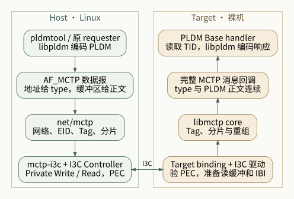

上次查 Target 的 TID，Host 打印了六个字节。

```text
response: 01 03 00 02 00 01
completion_code=0x00
tid=1
```

开头和结尾都是 `01`。第一个表示这条 MCTP 消息承载 PLDM，最后一个才是设备返回的 TID。还有一个容易漏掉的细节：这行是原 requester 把类型和正文放在一起打印的。在我们部署的内核上，应用实际从 socket 数据区读到的是后面五个字节。之前 Host 就在这个边界多放了一个类型字节，链路能通，Target 看到的命令却错了一位。[实板 GetTID 记录](/2026/11/27/mctp-pldm-porting-software-architecture/evidence/03-base-get-tid.log) · [当时的定位过程](/2026/11/26/i3c-mctp-regression-milestone-20261126/)

## 一张图看清两端各跑什么

Host 和 Target 共同遵守 MCTP 的包格式，各自有一套收发实现。Host 用 Linux 内核的 MCTP 栈，应用通过 `AF_MCTP` 访问它。我们交付的裸机端点把 `libmctp` 编进固件组件，应用通过回调接收消息。两头都用到 `libpldm`，因为两头都要读写 PLDM 字段。



[打开完整架构图](/2026/11/27/mctp-pldm-linux-kernel-and-libraries/software-roles.svg)

| 软件 | 交给它什么 | 它替调用方处理什么 | 它看不到什么 |
|---|---|---|---|
| Host 的 `AF_MCTP` 与 `net/mctp` | 目的 network、EID、消息类型及正文 | 路由、消息 Tag、按 MTU 分片、接收重组、投递到 socket | TID 的含义、哪条 PLDM 命令成功 |
| Target 的 `libmctp` | binding 交上来的 MCTP packet，或应用要发送的完整消息 | MCTP 包与消息互转、接收回调、Control 处理 | I3C FIFO 是否装好、主机是否真的读完 |
| 两端所用的 `libpldm` codec | 命令字段或一段 PLDM 字节 | 检查并编解码头、命令参数、响应数据 | 设备当前的 TID、去哪个 EID 发、等多久 |

## Host 从哪里得到去往 EID 9 的路

这台 Host 运行 `6.6.36-slim-mctp`。`CONFIG_MCTP=y` 把通用消息栈编进内核。传输侧由 `mctp-i3c.ko`、I3C core 和 SVC 主控驱动配合；I3C binding 的来源是 Linux v6.8，回移时适配了当前板的读长度和包长约束。看到这几个模块就能解释 MCTP 怎么上总线。PLDM Base 命令的实现还得去用户态程序和对端固件里找。[Linux 的 MCTP 栈结构](https://docs.kernel.org/networking/mctp.html) · [v6.8 I3C binding 源码](https://github.com/torvalds/linux/blob/v6.8/drivers/net/mctp/mctp-i3c.c)

`mctp` 工具通过 netlink 查看或配置内核的网络对象。下面四个命令读的是本机状态，都不会向 Target 发一条 GetTID。

| 命令 | 这次记录里能看到什么 | 内核发送时怎样用它 |
|---|---|---|
| `mctp link show` | `mctpi3c0` 在 network 1，UP，MTU 68 | 选择承载接口及包长 |
| `mctp address show` | 本地 EID 8 | 形成 MCTP 源地址 |
| `mctp route show` | 到 EID 9 的路由指向该接口 | 按 network、目的 EID 查出口 |
| `mctp neigh show` | EID 9 对应一个六字节 I3C PID | binding 按 PID 找到枚举后的设备，从设备描述符取得当前动态地址 |

这次 I3C 枚举后动态地址是 `0x44`。Host 上的 network 1 是本地的 EID 地址空间标识，不会作为一个额外字节发上 I3C。路由和邻居由脚本按固定拓扑配置，这套部署没有常驻的 `mctpd` 去动态发现、分配 EID，也没有 `pldmd` 和 D-Bus 服务来代为完成查询。[当时的接口、路由及邻居表](/2026/11/27/mctp-pldm-porting-software-architecture/evidence/mctp-binding-and-route.log)

### 第一段代码：应用交给 socket 的三个字节

取实例号 3，GetTID 的请求正文恰好只有三个字节。下面是独立写的发送示例。调用方持有已经打开的 `socket(AF_MCTP, SOCK_DGRAM, 0)`，同一描述符还要用来等待响应。

```c
#include <linux/mctp.h>
#include <stdint.h>
#include <sys/socket.h>

static ssize_t send_get_tid(int fd, unsigned int network, uint8_t eid)
{
    const uint8_t request[] = {0x83, 0x00, 0x02};
    struct sockaddr_mctp dest = {
        .smctp_family = AF_MCTP,
        .smctp_network = network,
        .smctp_addr = { .s_addr = eid },
        .smctp_type = 0x01,
        .smctp_tag = MCTP_TAG_OWNER,
    };
    return sendto(fd, request, sizeof(request), 0,
                  (const struct sockaddr *)&dest, sizeof(dest));
}
```

`0x83` 是 Request 位加实例号 3，`0x00` 是 PLDM Base，`0x02` 是 Base 里的 GetTID。另一个命名空间里的 `0x01` 放在 `smctp_type`。指定 `MCTP_TAG_OWNER` 后，内核为这笔请求分配可用的消息 Tag，保留响应回到这个 socket 所需的关联。这个 **3 位 MCTP Tag** 和 PLDM 头里的 **5 位 Instance ID** 可以有不同的值。函数返回 3，只表示内核接受了三字节正文；业务是否成功要等回包。

这里值得直接看 `net/mctp/af_mctp.c`：`mctp_sendmsg()` 先查 network/EID 路由，在 skb 中追加一字节 `smctp_type`，再复制用户数据。`mctp_recvmsg()` 则取出该类型，从偏移 1 开始复制正文，并在返回的 `sockaddr_mctp` 中填写类型、源 EID 和 Tag。随这棵 6.6 内核附带的文档示例还写着让应用自己把 type 放进发送缓冲区；移植到这台板时，应以这对函数和实际请求结果为准。[Linux v6.6 的发送与接收实现](https://github.com/torvalds/linux/blob/v6.6/net/mctp/af_mctp.c) · [同版本文档示例](https://github.com/torvalds/linux/blob/v6.6/Documentation/networking/mctp.rst)

### 从一个数据报到一次 I3C 写

1. `mctp_local_output()` 选择出口的本地 EID，处理 Tag，填好源、目的地址。需要切片时，`mctp_do_fragment_route()` 给各片写 SOM、EOM 和循环递增的两位序号。同一消息的各片沿用 Tag，类型字节只出现在首片。
2. `mctp_route_output()` 使用邻居表，把包送进 netdev。binding 的 `mctp_i3c_start_xmit()` 交给发送线程，再由 `mctp_i3c_xmit()` 找到 I3C 设备，计算写方向 PEC，发起 Private Write。
3. 返回时，Target 准备好响应，使用带 `0xAE` 的 IBI 通知 Host。Host 的 `mctp_i3c_ibi_handler()` 触发 `mctp_i3c_read()` 发起 Private Read。IBI 只通知“可以来读”，真正的响应在随后的读事务里。
4. 本板的读请求上限可以是 69 B，这次 GetTID 实际只返回 11 B。驱动按 `actual_len` 找最后一个字节验证 PEC，移除它，再调用 `netif_rx()` 上送。内核匹配 Tag 和地址；分片消息需由 `mctp_route_input()`、`mctp_frag_queue()` 收齐，应用才收到完整数据报。[Linux v6.6 的路由、分片与接收](https://github.com/torvalds/linux/blob/v6.6/net/mctp/route.c) · [I3C 绑定与本板适配](/2026/11/27/mctp-pldm-porting-software-architecture/)

## Target 为什么要有 libmctp

裸机上没有进程，也没有等在 `recvmsg()` 上的用户线程。`libmctp` 给平台留了两头接口：往下注册一个 binding，把包交给硬件；往上注册一个消息回调，把完整请求交给业务。初始化时，交付组件先 `mctp_init()` 创建实例，设置时钟和消息大小上限，以本地 EID 注册 binding，再用 `mctp_set_rx_all()` 安装 `on_message()`。消息类型 `0x00` 的 MCTP Control 请求由该版本的 Control 逻辑处理；类型 `0x01` 才进这里的 PLDM 分发。[固定版本 libmctp 的 core](https://github.com/openbmc/libmctp/blob/ab58506f08dbda562fccaa66340faad9c2e96fa4/core.c) · [Target 交付组件源码](/2026/11/27/mctp-pldm-porting-software-architecture/review-target-kit/src/chip_endpoint.c)

在接收方向，平台把 Private Write 的有效长度和动态地址交给 `chip_endpoint_rx()`。它按写方向验证 PEC，去掉末尾校验字节，把剩下的 MCTP 包交给 `mctp_bus_rx()`。假如收到的是首片且 EOM 尚未置位，PLDM handler 还拿不到可执行的命令。等消息完整后，回调才看到连续的 `[类型][PLDM 头][命令数据]`。**同一笔 GetTID，此处要跳过第一个字节，Host 的 AF_MCTP 数据区却从 PLDM 头开始。**

下面把回调中一条成功分支单独写出来。调用前已经确认这是发往本端的 Base/GetTID 请求、请求有 Tag Owner、头合法且命令数据长度为零；`local_tid` 来自端点状态。

```c
static int reply_get_tid(struct mctp *core, uint8_t requester_eid,
                         uint8_t tag, uint8_t instance, uint8_t local_tid)
{
    uint8_t message[1 + sizeof(struct pldm_msg_hdr) + 2] = {0x01};
    struct pldm_msg *pldm = (void *)(message + 1);
    int rc = encode_get_tid_resp(instance, PLDM_SUCCESS, local_tid, pldm);
    if (rc != PLDM_SUCCESS)
        return rc;
    return mctp_message_tx(core, requester_eid, false, tag,
                           message, sizeof(message));
}
```

回包目的 EID 取自来包源地址，Tag 沿用，Owner 清零，PLDM Instance ID 原样返回。库可以立刻把生成的 packet 交给 binding，主机却可能过一会儿才来读。因此 `binding_tx()` 复制包到软件队列；`chip_endpoint_tx_peek()` 再按**读方向**加 PEC，平台装好稳定的硬件发送缓冲后才发 IBI。读事务正常结束且实际长度吻合，`chip_endpoint_tx_complete()` 才把队头移走。这是交付组件和板级代码的接口约定。实板成功回包印证了外部行为，最新固件内的中断与主循环具体怎样交接，尚缺匹配的固件版本材料。[交付接口与完成条件](/2026/11/27/mctp-pldm-porting-software-architecture/review-target-kit/include/chip_endpoint.h)

## libpldm 管哪一段，pldmtool 又多做了什么

只给 `libpldm` 一个缓冲区，它就能编码 GetTID 请求，或者解出响应中的 TID。函数没有 network、EID 或 I3C 地址参数。设备端调用 `encode_get_tid_resp()` 时也要传入 TID，它的值由应用维护。

以端点采用的 v0.13.0 为例，核心数据结构是三字节的 `pldm_msg_hdr` 和后面的命令 payload。公共头处理函数负责 Request/Response、Instance ID、PLDM Type 和 Command；`src/dsp/base.c` 等按协议类型分组的 codec 再读写各命令专有字段。同一个成功响应，在 Base/GetTID 里第二个 payload 字节是 TID，换一个 Command 就得换解码器。

库里还提供可选的 transport 接口。比如 `pldm_transport_af_mctp_init()` 创建 AF_MCTP 后端，`pldm_transport_af_mctp_map_tid()` 在本地登记 TID 与 EID 的对应关系，上层才可以按 Terminus 选择目的端。登记映射不会发出 PLDM SetTID，也不会改变远端 TID。翻代码时能搜到这些函数；要判断板上走没走这条路，还得看应用的链接清单。[libpldm v0.13.0 的 transport 接口](https://github.com/openbmc/libpldm/blob/v0.13.0/include/libpldm/transport.h) · [AF_MCTP 后端](https://github.com/openbmc/libpldm/blob/v0.13.0/include/libpldm/transport/af-mctp.h)

| 谁在调用 | 本次使用的实现 | 收发与状态由谁管理 |
|---|---|---|
| 11 月 26 日实板用的原 requester | `libpldm v0.13.0` 的 Base codec | requester 自己操作 AF_MCTP；七项历史查询由它完成，其中三项是 MCTP Control |
| 后加入的 Host `pldmtool` | OpenBMC 2.14 配方锁定的 `pldm@25c999c`，配套 `libpldm@3a6a001`，静态链接 Base、FW Update 和公共函数 | 命令前端建请求，本地 `af-mctp.cpp` 用 `sendto → poll → recvmsg`；这个构建没有链接库里的 AF_MCTP transport backend |
| Target 交付组件 | `libpldm v0.13.0` 的 Base codec 与固定提交的 `libmctp` | Base handler 保存并读取端点 TID，libmctp 通过平台 binding 收发 |

新前端的 `GetTID::createRequestMsg()` 调用 `encode_get_tid_req()`。`CommandInterface::exec()` 交给本地传输适配，按截止时间等回应，检查源 network/EID、消息类型、响应方向、Instance ID、PLDM Type 和 Command。响应够长，且 Completion Code 表示成功，才交还命令解析函数。Host 此处用了两套独立静态构建，安装新工具后，旧 requester 仍使用原来的 codec。[固定版本的 OpenBMC Base 命令](https://github.com/openbmc/pldm/blob/25c999c98fbcf5142aefccf99790ce8b6ec99153/pldmtool/pldm_base_cmd.cpp) · [配套 Host codec](https://github.com/openbmc/libpldm/blob/3a6a001b6c1d755df762868a686adf57daefb8e1/src/base.c) · [Target 使用的 Base codec](https://github.com/openbmc/libpldm/blob/v0.13.0/src/dsp/base.c)

把旧日志交给同类解码函数，只需要下面这点数据。可单独运行这段离线 C 程序；`payload_length` 是去掉 PLDM 三字节头之后的长度。解码函数返回成功，说明回包可解析；只有对端 Completion Code 为成功时，才能使用输出的 TID。

```c
#include <libpldm/base.h>
#include <stdint.h>
#include <stdio.h>

int main(void)
{
    const uint8_t reply[] = {0x03, 0x00, 0x02, 0x00, 0x01};
    uint8_t cc = 0xff, tid = 0;
    size_t payload_length = sizeof(reply) - sizeof(struct pldm_msg_hdr);
    int rc = decode_get_tid_resp((const void *)reply, payload_length, &cc, &tid);
    if (rc != PLDM_SUCCESS || cc != PLDM_SUCCESS)
        return 1;
    printf("TID = %u\n", (unsigned)tid);
    return 0;
}
```

## 对着日志把长度算一遍

| 从哪里看 | GetTID 请求 | 成功响应 |
|---|---:|---:|
| Host 的 socket 正文 | `83 00 02`，3 B | `03 00 02 00 01`，5 B |
| 完整 MCTP 消息（含一次类型） | 4 B | 6 B |
| netdev 统计的 MCTP 包（加 4 B 头） | 8 B | 10 B |
| I3C 数据区（再加 1 B PEC） | 9 B | 11 B |

请求字节按日志中的实例号重建。响应、发包计数增加 8 B、收包计数增加 10 B 都能在原记录找到。这里的 9 B、11 B 按包格式换算，不含 I3C 地址阶段。[GetTID 原始计数](/2026/11/27/mctp-pldm-porting-software-architecture/evidence/03-base-get-tid.log)

短包成功后，我们又送了一条 **含类型共 65 B** 的测试消息。这次 binding 选择了 64 B 的 MCTP packet payload，第一片占满 `4 + 64 + 1 = 69 B`，第二片只剩 `4 + 1 + 1 = 6 B`。Host 的网络侧记录里有两片，硬件计数却只有一次发送成功；第二次写在 `0x44/W` 地址阶段收到 NACK。拉开间隔能让 Host 两笔写都报告成功，仍缺 Target 重组完成的证据。定位这一跳时，我会把网络侧的分片记录和主控的地址应答放在一起看。[连续两片的记录](/2026/11/27/mctp-pldm-porting-software-architecture/evidence/fragment-no-delay.log) · [I3C binding 规范 DSP0233](https://www.dmtf.org/sites/default/files/standards/documents/DSP0233_1.0.0.pdf)

截至 11 月 27 日，原 requester 的三项 Control 和四项只读 PLDM Base 已有实板结果，GetTID 返回 1。新 `pldmtool` 在原生和 AArch64 用户态仿真各通过 36 项离线检查，板上完成安装、校验和帮助命令检查；用这个前端做真实查询仍待回归。它带有 Type 5 信息查询入口，当前交付的 Target 只实现 Base handler。想判断后续某种服务能不能用，需要分别核对工具能发什么、设备声明什么、真实请求返回什么。[集成验证摘要](/2026/11/27/mctp-pldm-porting-acceptance-testcases/pldmtool-validation-summary.txt) · [验收用例](/2026/11/27/mctp-pldm-porting-acceptance-testcases/)
