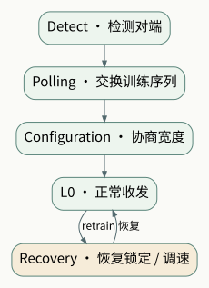

## 1. Link 不是“PCIe 总线的一根线”

一条 PCIe **Link** 只连接相邻的两个 Port，是 point-to-point、full-duplex 的通信通道。它可以由 1、2、4、8、16 条 **Lane** 组成；每条 Lane 又有一对 TX 差分线和一对 RX 差分线。

因此 `Gen4 ×8` 同时说了两个维度：

- 每 Lane 的 signaling rate 是 16.0 GT/s；
- 8 条 Lane 聚合成 Link。

`GT/s` 是每秒传输次数，不直接等于应用数据 GB/s。编码、TLP/DLLP header、flow control、replay 和实际 workload 都会占用带宽。Gen1/2 使用 8b/10b，Gen3/4 使用 128b/130b，因此仅按 signaling rate 和 Lane 数换算得到的是理论线路速率，不是应用可获得的有效吞吐。

REFCLK、PERST#、AC coupling 和 Lane 连线是板级与 PHY 检查的起点。它们准备就绪后，还要区分训练允许、物理 Link Up 和 Data Link 初始化完成；这些条件不能用一个状态位互相代替。

## 2. LTSSM 解决什么问题

上电时，两端还不知道：

- 对面是否真的存在、接收端 termination 是否可检测；
- bit/symbol/block 能不能锁住，Lane 极性是否反了；
- 哪些物理 Lane 可用，能组成多宽的 Link；
- 双方共同支持的最高 speed；
- 多 Lane 到达时间差怎样 de-skew；
- 发生误码、速率切换或电源状态变化后怎样恢复。

**LTSSM**（Link Training and Status State Machine）是 Physical Layer 的硬件状态机，用 Ordered Sets 和电气状态完成这些协商。它不是 Linux 线程，也不是固件里一串 `switch-case`。软件可以允许/禁止训练、请求 retrain、读 status；但每个 TS1/TS2 的发送接收由硬件完成。



图中只画了初次训练和重训这两条常见路径。排查时，记录进入和离开每个状态的时刻，比单独保存最后一个状态更容易看出在哪里打转。

## 3. 第一次建链的主干

```text
Fundamental Reset
 → Detect.Quiet
 → Detect.Active
 → Polling.Active
 → Polling.Configuration
 → Configuration.Linkwidth.Start
 → Configuration.Linkwidth.Accept
 → Configuration.Lanenum.Wait / Accept
 → Configuration.Complete
 → Configuration.Idle
 → L0 at 2.5 GT/s
 → optional Recovery.Speed / Equalization
 → L0 at highest common speed
```

Base Spec 要求 Link 首先以 2.5 GT/s 进入 L0，即便双方都支持更高 speed。更高能力通过 TS1/TS2 广告，之后从 L0 进入 Recovery 完成 rate change；Gen3/Gen4 还涉及 equalization。

### 3.1 Detect：先看看对面有没有终端

`Detect.Quiet` 中 transmitter 为 Electrical Idle，并保证接收 termination 条件和 Gen1 频率准备好。`Detect.Active` 执行 receiver detection；成功的 Lane 才进入 Polling。

这一步还没有“交换设备 ID”，甚至没有正常 packet。若卡住，优先看 power、PERST#/reset、refclk、PHY PLL/PIPE 与接收 termination，不要先怀疑 BAR——BAR 此时还没登场。

### 3.2 Polling：建立接收锁定并交换 TS1/TS2

`Polling.Active` 发送 TS1，接收端建立 bit lock、symbol lock（高代际为 block alignment），并处理 Lane polarity。`Polling.Configuration` 主要交换 TS2，确认两端已经能稳定识别 training sequences。

TS1/TS2 是 Ordered Set，不是 TLP，也不经过 BAR/config-space routing。它们携带 Link/Lane number、支持速率、training control 等物理训练信息。

### 3.3 Configuration：确定 Lane 编号与 Link 宽度

这一组子状态协商 Link number、Lane number 和 width，处理 lane reversal、de-skew，最终在 `Configuration.Complete/Idle` 结束。

物理布线支持 ×16，不代表最终一定建立为 ×16。若部分 Lane 的连接或信号质量存在问题，Link 可能 downtrain 为 ×8、×4 或 ×1。因此，Link 已经 Up 但协商宽度低于预期，是需要单独排查的一类故障。

### 3.4 L0：正常收发 packet

L0 是正常工作状态，TLP/DLLP 可以传输，也是 ASPM 等 power state 的出发点。Link Status 中 negotiated width/speed 此时有效。

### 3.5 Recovery：不一定是故障

Recovery 用于：

- 改变 speed；
- 重新获得 bit/symbol/block lock 和 de-skew；
- Gen3+ equalization；
- 更新 N_FTS；
- 某些错误后的 link retraining；
- 转往 Configuration、Loopback、Disabled、Hot Reset。

偶尔经过 Recovery 可能只是正常 speed change；频繁 `L0 ↔ Recovery` 才通常提示信号完整性、clock、equalization 或 error recovery 问题。观察状态历史比只读当前状态强得多。

来源：Base Spec 5.0 §§4.2.4.13、4.2.5–4.2.6，printed/PDF pp.312–365。

## 4. L0/L0s/L1/L2 不是 Function 的 D-state

| 维度 | 状态例子 | 描述对象 |
|---|---|---|
| LTSSM / Link power | L0、L0s、L1、L2 | 相邻两个 Port 之间的物理 Link |
| PCI PM Function state | D0、D1、D2、D3hot、D3cold | 一个 PCI Function 的功能/供电状态 |

两者有关联，但并不相等。一个 Function 进入低功耗可能促使 Link 进入 L1；一条 Link 后面也可能挂多个 Function。把 D3hot 和 L1 当成同义词，会混淆 Function 状态与 Link 状态，进而导致 power debug 的检查对象和控制路径出错。

## 5. Physical LinkUp 之后还要 Data Link 初始化

LTSSM 进入 L0 后，Physical Layer 报告 LinkUp。Data Link Control and Management State Machine 还要走：

```text
DL_Inactive
 → optional DL_Feature exchange
 → DL_Init: VC0 Flow Control InitFC1 / InitFC2
 → DL_Active
 → report DL_Up
```

在 DL_Feature 阶段仍报告 DL_Down；DL_Init 的 FC_INIT1 也报告 DL_Down，直到 FC_INIT2 才开始 DL_Up。只有 credits 初始化好，双方才知道各自 receive buffer 能接多少 Posted/Non-Posted/Completion traffic。

因此调试时至少区分：

1. receiver detect 成功；
2. LTSSM 到 L0 / Physical LinkUp；
3. Data Link DL_Up；
4. Config Read 能完成；
5. software enumeration 成功。

来源：Base Spec 5.0 §§3.2–3.4，printed/PDF pp.210–220。

## 6. Link Down 如何冲击上层

Base Spec 的 Data Link Layer 从 DL_Active 回到 DL_Inactive 时：

- report DL_Down；
- retry buffer/state 被清；
- Transaction Layer 丢弃 outstanding transaction/终止发送；
- Downstream Port 语义近似 hot-remove，Upstream Port 语义近似 hot reset；
- 非预期条件下可形成 Surprise Down error。

## 7. 软件看到的 Link

Linux/固件通常通过 PCIe Capability 的 Link Status/Control 查看或控制：

- negotiated Link Speed；
- negotiated Link Width；
- Link Training；
- Data Link Layer Link Active（若实现）；
- Link Disable / Retrain Link；
- target speed 在 Link Control 2。

软件写 Retrain Link 之后，由硬件推进训练。若成功回到 L0，还要读回协商速率和宽度。一次训练成功也可能只建成了较窄的链路。

## 8. 参考资料

- PCI Express Base Specification 5.0 r1.0, §§3.1–3.4, printed/PDF pp.209–220。
- PCI Express Base Specification 5.0 r1.0, §§4.2.4.13–4.2.6.4, printed/PDF pp.312–365。
