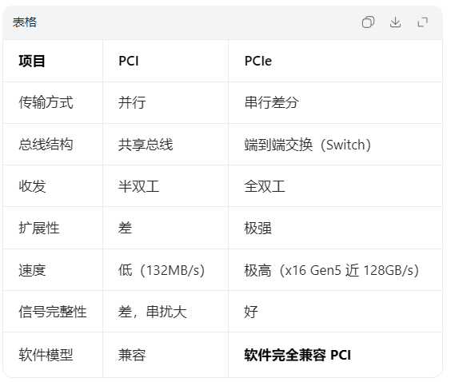
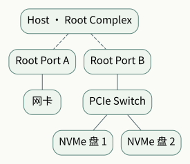
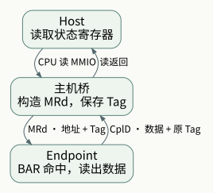

## 1. 从哪里开始理解

PCI Express 是一种面向高性能 I/O 的、点到点、全双工、分组化互连。它在线路和协议上更像一张小型网络，却刻意保留了 PCI 的软件模型：操作系统仍通过 Configuration Space 发现设备、用 BAR 分配地址，再以 load/store 语义访问设备。

这句话里藏着 PCIe 最重要的设计取舍：

- 对硬件来说，它把共享并行总线换成高速串行 Link、Switch 和 packet protocol。
- 对软件来说，它尽量让旧 PCI 的枚举、配置和驱动模型继续工作。

理解 PCIe 时，可以同时保留这两个视角：线上协议发生了很大变化，软件仍沿用配置、枚举和资源分配模型。

Base Spec 5.0 §1 与 §1.1 明确说明 PCIe 保留 PCI 的 usage model、load-store architecture 和 software interfaces，同时把 parallel bus 替换为 scalable serial interface，并要求 PCI-compatible software model。来源：`PCI_Express_Base_Specification_Revision5.0r1.0.pdf`，printed/PDF pp.89–90。

## 2. 为什么它比 I2C / SPI 复杂这么多

先从熟悉的外设总线出发。

I2C/SPI 的典型问题是：“CPU 怎样给一个已知外设发几字节命令？”设备数量不多，拓扑通常固定，地址/片选由板级设计决定，事务大多由 CPU 主动发起。

PCIe 要同时解决另一组更麻烦的问题：

- 设备和 Switch 可能形成多级树，开机前软件不知道拓扑。
- 一个设备可以有多个 Function，每个 Function 都要被独立识别、配置和驱动。
- CPU 要访问 EP，EP 也要主动 DMA Host Memory；双方都可能是 Requester。
- 多个请求可以同时在途，返回顺序不必等于发出顺序，因此要靠 Tag 配对。
- 每条 Link 都要训练、协商速率和 Lane 数，链路还会省电、恢复和重训。
- 高速串行误码需要链路级检测、ACK/NAK 和 Replay，同时还要有端到端错误语义。
- 系统必须分配 MMIO 地址、路由中断、隔离 DMA，并在设备出错时尽量恢复。

如果把 SPI 看成“两个人拿着对讲机按约定说话”，PCIe 更像“有地址规划、路由、信用额度、可靠传输和事故上报的园区网络”。只是这张网络最终仍要让 CPU 感觉自己在读写寄存器。

### 从 PCI 到 PCIe：软件模型保留了什么

传统 PCI 使用共享并行总线；PCIe 改为点到点串行 Link，并通过 Switch 组织拓扑。它保留的是配置、资源和驱动模型的延续性，不表示所有平台行为和硬件实现都完全相同。



这张对照图沿用早期笔记。图中的 Gen5 x16“近 128 GB/s”采用双向合计口径；单方向扣除 128b/130b 编码后约为 63 GB/s，还没有扣除 TLP 等开销。“软件兼容”也应理解为模型兼容，设备与平台特性仍需各自的驱动和配置。

从 CPU 看，PCIe 把 MMIO、中断和 DMA 的访问模型延伸到了外部设备：CPU 经 BAR 窗口访问寄存器，设备通过 DMA address 访问 Host buffer，再用 MSI/MSI-X 通知完成。三个方向对应不同的地址与权限，不能把 BAR、CPU 物理地址和 IOVA 混为一谈。CXL 可以复用相应代际的 PCIe 物理接口，但 UPI 是另一种处理器互连，不能统一当作 PCIe。

## 3. Link 与 Lane：x4 表示什么

### 3.1 直觉

**Link** 是两个相邻 PCIe 组件之间的一条逻辑连接。它是 dual-simplex：A→B 和 B→A 各有自己的单向通路，因此两个方向可以同时传输。

**Lane** 是 Link 的最小物理宽度单位，包含：

- 一组发送差分对；
- 一组接收差分对。

多条 Lane 可以聚合成 x2、x4、x8、x16 等 Link。`x4` 表示四条 Lane 并行工作，并不表示单条 Lane 的时钟频率提高到四倍。

### 3.2 规范定义

Base Spec 5.0 §1.2 定义基本 Link 至少有一条 Lane，并列出 x1/x2/x4/x8/x12/x16/x32 宽度；每条 Lane 在每个方向都有一对差分信号。Gen1 到 Gen5 的 signaling rate 分别为 2.5、5.0、8.0、16.0、32.0 GT/s。

这里用 GT/s 而不是随手写成 GB/s，是因为线上传输还包含编码和协议开销。计算有效 payload 带宽时，还要扣除编码、包头和其他协议开销。

### 3.3 谁建立 Link

链路上电后，两个端口的硬件通过 Link Training 协商 Lane width 和 signaling rate。Base Spec §1.2 明确说这个初始化过程不需要 firmware 或 OS 参与。负责这一过程的硬件状态机叫 **LTSSM**（Link Training and Status State Machine）。

软件可以控制“允许训练”“请求 retrain”“目标速率”等策略，但 TS1/TS2 的具体收发由链路硬件完成，不是 Linux 软件逐周期驱动。

## 4. RC、Root Port、Endpoint 和 Switch



图中每条实线都是一条独立 Link。Host 可以枚举到三个端点，其中两块盘共享 Switch 向上的那一条 Link。

### 4.1 Root Complex（RC）

**直觉：** RC 是 Host 世界和 PCIe 世界的总入口。CPU、Host Memory 在一边，PCIe hierarchy 在另一边。

**规范：** Base Spec §1.3.1 把 RC 定义为 I/O hierarchy 的根，连接 CPU/memory subsystem 与 I/O。一个 RC 可以支持一个或多个 PCIe Port，每个接口形成单独的 hierarchy domain。

**硬件行为：** RC 需要把 CPU 侧的配置或 MMIO 访问转换为 PCIe Request，并把 EP 发往 Host Memory 的请求送到内存系统；是否支持跨 hierarchy domain 的 peer-to-peer routing 属于实现相关能力。

**软件视角：** Linux 会为 host bridge 建立 `pci_host_bridge`/root bus（对象关系可结合 [Linux PCI Core](/2026/11/27/pcie-linux-pci-core/) 阅读，具体 accessor 仍取决于内核与平台），从根总线开始枚举下游设备。

### 4.2 Root Port（RP）

Root Port 是 RC 向一个 hierarchy domain 暴露的 PCIe Port。它在配置模型上是桥型 Function，下游可以直连一个 EP，也可以连接 Switch。

常见误区是把 RC 和 RP 当成同义词。一个 RC 可以包含多个 RP：RP 是 PCIe hierarchy 顶部的一个端口，RC 则还包括 Host 侧连接、地址路由以及相关控制逻辑。芯片框图有时会把整个模块统称为 PCIe RC controller，因此阅读寄存器手册时，需要分清它指的是协议角色还是完整的 IP block。

### 4.3 Endpoint（EP）

**规范：** Base Spec §1.3.2 定义 Endpoint 是一种 Function，能够代表自己或非 PCIe 设备发起/完成 PCIe transaction。

一个 EP 可以扮演两种事务角色：

- **Completer：** Host 对它的 BAR 发 Memory Read，它返回 Completion with Data。
- **Requester：** 它的 DMA engine 向 Host Memory 发 Memory Read/Write。

因此“Endpoint 只能被动挨访问”是错的。没有 bus-master 能力的简单 EP 可以很被动，但高性能网卡、NVMe、GPU 恰恰大量主动发请求。

标准 PCIe Endpoint 使用 Type 0 Configuration Header，必须作为 Completer 支持 Configuration Request。如果设备需要中断资源，标准 Endpoint 需要支持 MSI 或 MSI-X；这些规则见 Base Spec §1.3.2.2，printed/PDF p.94。

### 4.4 Switch

PCIe Link 是点到点的，要连接多个设备就需要 Switch。Switch 根据地址或 ID 路由 TLP；在配置模型里，它由多个虚拟 PCI-to-PCI Bridge 组成：一个 Upstream Port 面向 RC，多个 Downstream Port 面向下游。

这解释了为什么 `lspci -t` 看到的是树，而不是一串共享在同一根线上的设备。Switch 不是“透明电线分叉器”，它有配置空间、桥窗口、Bus Number 和错误/电源管理职责。

## 5. Hierarchy 与 BDF：软件给树上的 Function 发门牌号

一组从 RC 接口向下展开的 Root Port、Switch 和 Endpoint 构成 PCIe hierarchy。软件用 **Bus / Device / Function（BDF）** 标识一个 Function，例如：

```text
00:01.0  Root Port
01:00.0  Endpoint Function 0
```

传统 BDF 编码中：Bus 8 bit、Device 5 bit、Function 3 bit。Bus Number 通常由 firmware/OS 在枚举桥层次时配置，不是焊死在 EP 里的身份证号；设备换个槽位或拓扑，BDF 可能变化。

BDF 后续会同时出现在三个世界：

- 软件对象和用户工具，例如 `0000:01:00.0`；
- Configuration Request 的目标与桥的 ID routing；
- TLP 中的 Requester ID / Completion 中的身份和错误归属。

配置与枚举的完整因果链将在独立文档中展开。

## 6. 三层协议各管哪摊事

PCIe Base Spec §1.5 把协议分成 Transaction、Data Link 和 Physical Layer。别急着背定义，先看一笔“CPU 读 EP 寄存器”的分工。

### 6.1 Transaction Layer：决定这笔业务是什么

CPU 读某个 BAR 地址，RC Transaction Layer 形成 Memory Read Request TLP。TLP 会描述：

- 这是 Memory Read；
- 读哪个地址、多少 DW；
- 谁发的（Requester ID）；
- 用哪个 Tag 区分在途请求；
- Byte Enable、Traffic Class、Attributes 等。

EP 收到后解析请求，命中 BAR，并返回 Completion with Data。Transaction Layer 负责 Request/Completion、routing 和 ordering 等端到端事务语义；它也按 traffic class/type 做 credit accounting，但 credit 是相邻 Port 在**每条 Link 上逐跳**维护的，不是从 EP 一路预订到 Host Memory 的端到端额度。

### 6.2 Data Link Layer：保证这一跳靠谱

TLP 每经过一条 Link，Data Link Layer 会加入 Sequence Number 和 LCRC。接收端校验成功后发 ACK，检测到可重试错误则发 NAK；发送端保留 Replay Buffer，必要时重传。

关键点：这是 **Link-local** 可靠性，不是端到端 Completion。ACK 只说明“相邻接收端正确收到了这个 TLP”，不说明最终业务已经成功。把 ACK 和 Completion 混在一起，是非常高产的一类误解。

### 6.3 Physical Layer：把包变成 Lane 上的信号

Physical Layer 负责 framing、编码/扰码、Lane 分发与对齐、训练序列、LTSSM 和真实电气传输。它把上层数据送进 SerDes/PHY，也从多个 Lane 恢复出有序数据。

Base Spec 的职责概览见 §1.5.1–1.5.4，printed/PDF pp.97–102。

## 7. 一次 Memory Read 的最小故事

假设：

```text
RC / Root Port: 00:01.0
EP:             01:00.0
EP BAR0:        PCI address 0x8000_0000，size 64 KiB
目标寄存器:      BAR0 + 0x100
```

Linux 驱动从 `pci_iomap()` 得到映射后的 `__iomem` 虚拟地址，再调用 `readl(bar0 + 0x100)`。概念路径是：

```text
CPU load
 → 虚拟地址翻译为 CPU physical MMIO address
 → Host bridge / RC outbound window 匹配
 → 形成目标 PCI address = 0x8000_0100 的 Memory Read TLP
 → Data Link 加 Sequence Number/LCRC
 → Physical Layer 在 Link 上发送
 → EP 校验、解析、BAR0 hit
 → EP 内部 AXI/APB 读取寄存器
 → EP 形成 Completion with Data
 → 沿 Link 返回，RC 用 Requester ID + Tag 匹配原请求
 → CPU load 得到数据
```

注意这只是概念路径：CPU physical MMIO 是否等于 PCI address、RC 是否做地址平移，要看 host bridge window 和 SoC 集成。PCIe 最喜欢在“地址”前面藏形容词，后续会专门拆开 CPU、PCI 和 DMA address。

## 8. 把控制器放回一次访问里



Host 想读设备的状态寄存器。CPU 先访问映射好的 BAR，主机桥形成 MRd，Endpoint 找到 BAR 对应的寄存器，把读出的数据装进 CplD。若分析仪只看到 MRd，接下来找的是 EP 有没有响应；若只在 CPU 上看见一次读超时，还分不出是哪一段失去了响应。

## 9. Debug 入口

遇到问题先按层问：

1. Link 是否进入 L0？若否，查 clock/reset/PHY/LTSSM/training。
2. Link up 但无设备？查 Configuration access、Bus Number、RP/EP mode、配置请求和 Completion/UR。
3. 能枚举但 BAR 访问失败？查资源分配、Command.MSE、主机窗口、TLP 地址，以及 Endpoint 对 BAR 内偏移的译码。
4. MMIO 正常但 DMA 失败？查 Command.BME、DMA address/IOMMU、MRd/MWr、Completion、cache sync。
5. DMA 完成但没中断？查 MSI/MSI-X capability/table、Memory Write、interrupt remapping 和 Linux vector。

先确认问题发生在哪一层，再选择观察点。例如，链路已正常工作时，DMA mapping 错误就应沿地址和 IOMMU 路径排查。

<a id="common-misconceptions"></a>

## 10. 常见误区与概念辨析

### BAR 是一块 memory 吗？

不是。BAR 是 Configuration Space 中描述地址窗口属性、大小并接受系统分配基址的寄存器。窗口背后可以接寄存器、SRAM、doorbell、frame buffer 或设备内部地址翻译逻辑。窗口对应的地址与窗口背后的设备资源需要分开理解。

### PCIe address 等于 CPU physical address 吗？

不保证。Host bridge 可以把一段 CPU physical MMIO window 翻译到另一段 PCI bus address。是否相等由平台地址图和 outbound translation 决定。

### DMA address 等于 physical address 吗？

不保证。它是设备应该发出的地址；在 IOMMU 存在时通常是 IOVA。即使没有 IOMMU，架构 DMA offset、bridge window 等也可能让它不同于 CPU physical address。

### `pci_iomap()` 返回的是 PCIe 地址吗？

不是。它返回 CPU 可用的 `__iomem` 虚拟地址。CPU 访问该虚拟地址后，经页表/I/O mapping、host bridge window，最终才可能变成某个 PCIe address 的 Memory TLP。

### Memory Write TLP 有 Completion 吗？

正常 Memory Write 是 Posted Request，没有正常 Completion。Data Link ACK 也不是 Completion，它只确认相邻 Link 正确收到包。若要确认写入在协议或设备层生效，驱动通常需要设备定义的状态、doorbell/queue 语义，或一次具有 ordering 意义的 read；具体方法必须依据设备协议，不能脱离适用条件泛化。

### Memory Read 为什么需要 Completion？

Memory Read 是 Non-Posted Request。Requester 发 MRd 后保留 Tag/outstanding state，Completer 用一个或多个 CplD 返回数据。请求与返回是 split transaction，不会长期占住共享总线等回应。

### PCIe DMA 是 PCIe Controller 替 Endpoint 搬数据吗？

设备需要 DMA engine 负责读描述符、拆分工作和通知完成。它可以集成在 PCIe 控制器中，也可以属于设备的业务逻辑；在链路上看到的仍是 Endpoint 发出的 Memory Request。

### MSI 是一根新硬件中断线吗？

不是。MSI 的本质是设备向系统配置的 Message Address 写入 Message Data，即一笔 Memory Write。系统的中断控制器或重映射单元把这笔写解释为中断，因此不需要为每个中断事件增加一根独立物理信号线。

### MSI到了，之前的DMA数据就一定可见吗？

同一Function、同一TC、默认ordering的早先Posted Writes不能被后发MSI MWr超车。但如果data和MSI使用不同TC，两个TC之间没有默认顺序保证；device必须使用同TC或zero-length Read等明确同步手段。“中断来了但buffer还旧”不一定是cache bug，也可能是跨TC ordering设计错误。

### PCIe 上的 INTx 还是四根贯穿链路的线吗？

不是。PCIe 保留传统 INTx 的软件/level semantics，但在 Link 上用 Message 传递 assert/deassert 事件。设备封装可能还有本地 sideband interrupt interface，那是 controller 与 application logic 的接口，不等于 PCIe fabric 上的物理 INTx 线。

### LTSSM 属于软件状态机吗？

不是。LTSSM 是 Physical Layer 硬件状态机。软件可以读状态、开关 training 或请求 retrain，但 Detect/Polling/Configuration 等训练过程由链路两端硬件完成。

### Enumeration 是 Endpoint 自己完成的吗？

不是。EP 暴露 Configuration Space 并响应 Configuration Requests；firmware/OS 从 RC 出发扫描 topology、分配 Bus Number 和资源、写 BAR/bridge window，并创建软件设备对象。

### Bus Number 是硬件固定的吗？

通常不是。Bus Number 是枚举层次时写入桥寄存器并用于 ID routing 的拓扑编号。设备换槽或桥层次变化后 BDF 可以改变，驱动不应把某个 BDF 当永久身份。

### Root Complex 和 Root Port 是同一个东西吗？

不是。RC 是连接 CPU/memory subsystem 与 I/O hierarchy 的根；一个 RC 可以有多个 Root Port。RP 是其中向下游 hierarchy 暴露 Link 的端口/桥型 Function。

### Endpoint 只能被 Host 访问，不能主动发请求吗？

EP 收到 BAR 访问时是 Completer，主动做 DMA 时则是 Requester。看图时先标出哪一方发起了这一笔访问，再读本地总线上的接口名称。

### Link Up 就等于设备已经可用吗？

远远不够。Link Up 通常只表示 LTSSM 到达可传输状态。配置访问、枚举、BAR/resource、Command.MSE/BME、DMA mapping、MSI 和功能驱动都还可能失败。

### Function power state 与 Link power state 是一回事吗？

不是。D0/D1/D2/D3 描述 Function 电源状态；L0/L0s/L1/L2 描述 Link 状态。二者有关联，但属于不同状态机和控制面。

### `pci_enable_device()` 会自动允许 DMA 吗？

不能这样概括。是否设置 Bus Master Enable、资源与电源状态如何处理，需要沿目标 Linux 版本源码确认。驱动通常显式调用 `pci_set_master()` 允许设备发 Memory/I/O Request；具体调用可结合 [Linux 功能驱动](/2026/11/27/pcie-linux-function-driver/) 阅读。

### MPS 和 MRRS 都是“最大包长”吗？

不是。MPS 限制带数据 TLP 的 payload；MRRS 限制 Function 一笔 Memory Read Request 最多请求多少数据。一个 MRRS=512 B 的 MRd 仍可能因 RCB/MPS 被拆成多个 CplD。

### Flow Control Credit 是端到端额度吗？

不是。Credit 在每条 Link 两端逐跳维护；Switch 收到 TLP 后，在下一条 Link 上重新受那一跳的 P/NP/Cpl header/data credit 约束。两段 Link 可以在同一时刻有不同的可用额度。

### No Snoop 会让 TLP 更容易乱序吗？

不会。No Snoop 是 cache coherency 属性，规范明确说它不改变 transaction ordering。需要讨论 passing 时看 RO/IDO 和同一 TC 的 ordering rules。

### VC 是把物理 Lane 虚拟成多个通道吗？

Lane 是物理传输通道。VC 在同一条 Link 上为不同的流量提供独立的流控资源。包头里的 TC 选择服务类别，由端口的映射决定使用哪个 VC。

### TC 数字越大，优先级就越高吗？

规范没有定义这种朴素的数字优先级。TC0～TC7 是服务类别标签，真实 QoS 取决于整条 hierarchy 的 TC→VC mapping、Port arbitration 和可用资源。只在一个 EP 上写 TC7，并不能保证获得更高优先级。

### Capability 总图画了一个方框，当前芯片就一定支持吗？

在对应 Function 的配置空间里遍历能力链，找到 Capability ID，再读其中的支持位和使能位。系列产品手册上的框图不能单独说明一块板的实际配置。

### Link Down、Hot Reset 和 FLR 可以用同一恢复流程吗？

Link Down 会影响整段路径，FLR 的范围是单个 Function。恢复前先确认其他 Function 是否仍在使用设备，再核对本次复位影响的寄存器、队列和中断设置。

### 找到 Capability 就能直接置 Enable 吗？

不行。Capability 只证明 Function 暴露这套结构；ARI、ATS、MSI-X、SR-IOV 等还需要上游 path、平台/IOMMU/IRQ资源和 Linux subsystem 共同准备。绕过内核直接改 Enable bit，可能造成硬件状态与操作系统管理状态不一致。

## 11. 参考资料

- PCI Express Base Specification 5.0 r1.0, Chapter 1, especially §§1.1–1.5, printed/PDF pp.89–102。
- [PCI-SIG 规范目录](https://pcisig.com/specifications)
