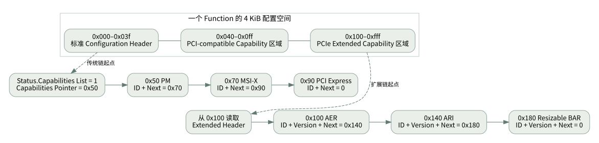
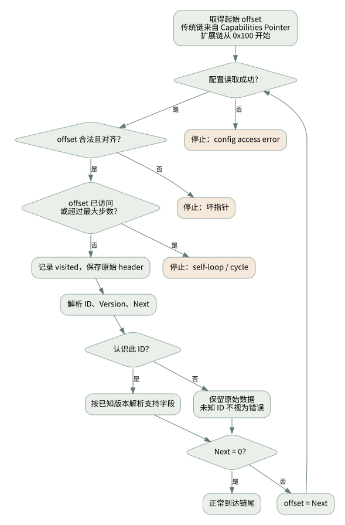
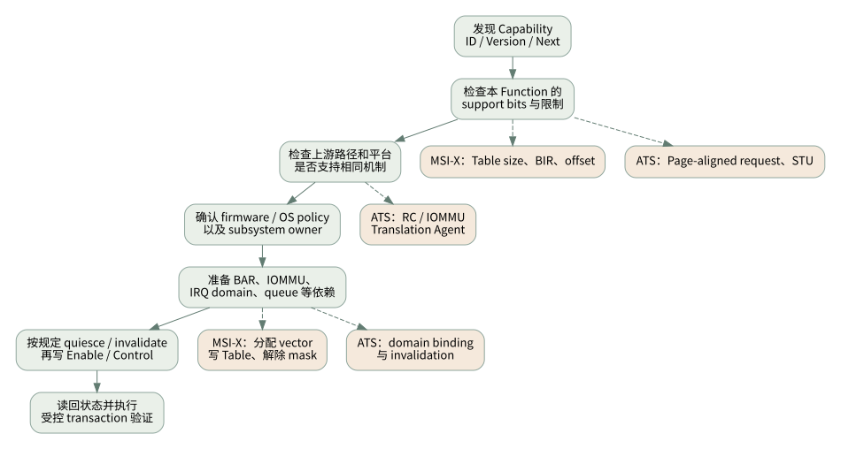

## 1. 为什么不是一个固定大结构体

PM、MSI-X、AER、ATS、SR-IOV 并非每个 Function 都实现。PCIe 用可遍历 capability 结构让硬件按需组合；软件先发现 capability，再按版本/能力位决定能否启用。

## 2. 两类 Capability 链表

| 类型 | 地址范围 | header/next | 常见能力 |
|---|---|---|---|
| PCI-compatible Capability | `0x40–0xff` | 8-bit ID + 8-bit next pointer | PM、MSI、MSI-X、PCI Express |
| PCIe Extended Capability | `0x100–0xfff` | 16-bit ID + 4-bit version + 12-bit next offset | AER、ACS、ARI、ATS、SR-IOV、L1SS、PASID、PRI |

先用一张图建立整体位置感。下面的 offset 只用于展示遍历方法，并不是所有设备都采用这些地址：

[打开原尺寸图](/2026/11/27/pcie-capability-safe-walking/capability-space-and-chains.svg)

上半条链的起点来自标准 Header 中的 Capabilities Pointer；下半条链没有单独的起始指针，软件直接检查 `0x100`。两条链最终都依赖各节点的 `next` 字段，而不是依赖能力名称或固定排列顺序。

传统链从 Status.Capabilities List 和 Header 的 Capabilities Pointer 开始。Extended Capability 通常从 `0x100` 检查 header，再跟 next pointer。next=0 表示链尾；offset 应满足规定对齐/范围。

区分“最后一项”和“一个扩展能力都没有”，可以避免误把下一项地址读成能力 ID。

- **链尾**：最后一个真实 Extended Capability 保留自己的非零 ID/version，只把 `Next Capability Offset` 设为 `000h`；
- **Configuration Space 根本没有 Extended Capability**：offset `0x100` 的 header 应为 ID=`0000h`、version=`0`、next=`000h`；
- **RCRB（Root Complex Register Block）根本没有 Extended Capability**：起始 header 使用 ID=`ffffh`、next=`000h`。

因此，当普通 Function 的 `0x100` 读回全 1，先排除配置读失败。对照王齐教材 §4.3.3 时尤其要留意，PCIe 5.0 §7.6.1 和 §7.6.2 分别描述了 Function 配置空间和 RCRB。

## 3. 安全 walker 要防坏链

真实硬件/仿真模型可能给出：越界、未对齐、next 指向自身、环、全 1 config read。walker 应：

1. 检查 config access 成功；
2. 校验 offset 范围与对齐；
3. 设最大遍历次数或 visited bitmap；
4. 解析 ID 前保存原始 header；
5. 不因未知 ID 停止，按 next 继续；
6. 同一 ID 可能有多个 instance，不能只假定一个。

Linux driver 应优先使用 `pci_find_capability()`、`pci_find_next_capability()`、`pci_find_ext_capability()` 等 PCI core API，不自己写脆弱链表循环。

安全 walker 的控制流程可以概括为：每走一步，先证明当前 offset 值得信任，再解释 header。顺序不要反过来。

[打开原尺寸图](/2026/11/27/pcie-capability-safe-walking/capability-safe-walk.svg)

走到未知 ID 时可以继续跟 next。真正需要退出的是读失败、偏移非法、环路或正常到达链尾。

## 4. 能找到不等于能直接用

发现 capability 后仍要检查：

- capability version 和具体 support bits；
- 上游 path 是否也支持/enable，例如 ARI/ATS/ACS；
- firmware/OS policy 与 ownership；
- 设备当前 power/reset 状态；
- enable 前后所需 quiesce/invalidate/barrier；
- Linux subsystem 是否已拥有该 capability。

例如找到 MSI-X 只能证明 table/PBA 描述存在；Host 还要分配 vector、写 table、解 mask 并建立 irq-domain。找到 ATS 也不代表设备可随意缓存 translation；IOMMU 与 invalidation protocol 必须共同就绪。

因此，“发现 capability”和“功能可以安全工作”之间还有一条完整的准备链：

[打开原尺寸图](/2026/11/27/pcie-capability-safe-walking/capability-enable-dependencies.svg)

图中的横向主链适用于多数可选能力；虚线分支说明不同 capability 的准备内容并不相同。通用 Function driver 不能只找到一个 offset、置一个 Enable bit，就认为平台其余部分会自动就绪。

反过来，真正的 **PCIe device Function 必须实现 PCI Express Capability**，其 Status.Capabilities List 位也必须硬连为 1。某个可选寄存器组可以不实现，某项 Extended Capability 也可以缺席，但“这是 PCIe Function，却连 ID `0x10` 的 PCI Express Capability 都没有”不是正常的精简配置。若扫描不到它，应先怀疑配置访问、链指针、设备类型或硬件实现。来源：Base Spec 5.0 §§7.5.1.2、7.5.3。

### 4.1 怎样处理新版本和陌生 ID

2003 年教材里的 PCI Express Capability 只画到 Device/Link/Slot/Root 第一组寄存、Extended Capability 也只列 AER、VC、DSN、Power Budgeting 四种。PCIe 5.0 的 Capability version 2 已增加 Device/Link/Slot Capabilities/Control/Status 2，Extended Capability ID 更是长了一大串。

通用 software 因此应：

- 先按 ID 找 structure，再按 version 和 support bit 解释已知字段；
- 对比自己更新的 version 保留已知前缀的兼容解析，不要因为“version 不等于 1”就整块拒绝；
- 对未知 Extended Capability ID，仍用 next pointer 继续走链；
- 不把某本书或某一个 build 的 capability 列表当成所有 PCIe 实现都具备的固定集合。

一个具体年代标记是 Tag：旧教材只讲 5-bit/8-bit Extended Tag，PCIe 4.0 开始又引入 10-bit Tag，其 Requester/Completer support 和 enable 位在 Device Capabilities/Control 2。把旧表拉到 Gen4/Gen5 硬件上照抄，会直接丢掉新的 outstanding request 能力。

## 5. 同一设备的 PF 和 VF，起始位置可以不同

假设驱动在 PF 上找到了 MSI-X。处理 VF 时仍要从 VF 自己的配置空间找一次；哪怕两者都有 MSI-X，它们前面的能力数量也可能不同。复用 PF 的偏移，有可能恰好读到另一个能力的控制字。

要记录这个差别，可以把每项的 BDF、offset、ID、version 和 next 打出来。先看链指针走到了哪里，再解释该设备支持的功能。

## 6. 建议的 capability dump 表

| BDF | offset | ID/version | next | enabled | path prerequisite | owner |
|---|---:|---|---:|---|---|---|
| `01:00.0` | `0x...` | MSI-X | `0x...` | yes/no | BAR table 可达 | PCI MSI core |
| `01:00.0` | `0x...` | AER v2 | `0x...` | masks | Root Port service | AER core |
| `01:00.0` | `0x...` | ATS | `0x...` | yes/no | IOMMU+TA | IOMMU/SVA |

同时保留完整 raw config snapshot；只保存 `lspci -vv` 的解码结果，遇到工具版本不认识的新 capability 时会失去证据。

## 7. Debug

- Capability pointer 为 0：先查 Status capability-list bit 和 build 是否实现。
- `lspci` 在某 offset 后不再列能力：检查 next pointer/self-loop/config read error。
- capability 可见但 Linux 不启用：查 path/firmware policy/kernel config/driver API，不先改 enable bit。
- 设备 reset 后 capability 值改变：区分 RO capability、RW control、sticky/reset domain。
- VF 与 PF capability 不同是正常的；不要拿 PF offset 直接读 VF。

## 8. 参考资料

- PCIe Base Specification 5.0 r1.0, §§7.5.3、7.6–7.9。
- 王齐《PCI Express 体系结构导读》，§4.3.3，printed p.133 / PDF p.145（作为年代差异与勘误样本）。
- [Linux v6.6 的 Capability 遍历实现](https://github.com/torvalds/linux/blob/v6.6/drivers/pci/pci.c)
